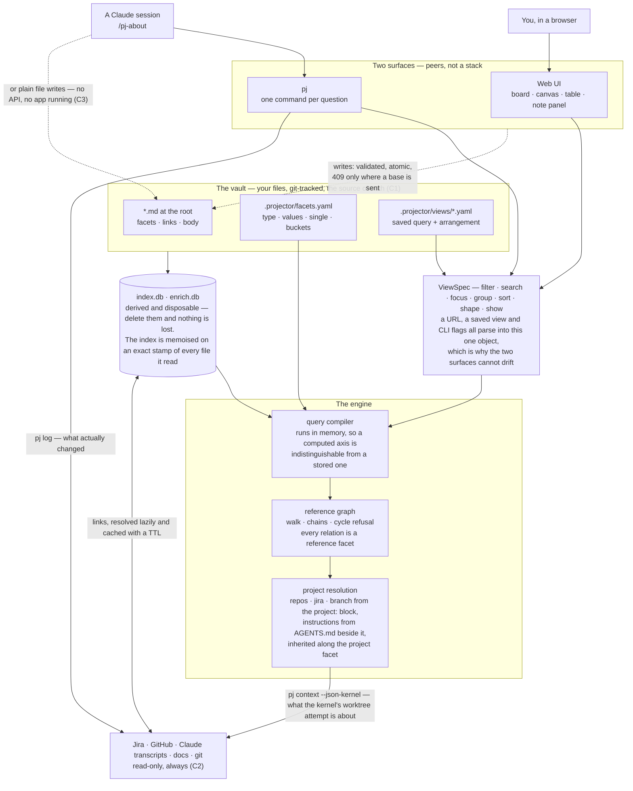

# Architecture

How projector works inside, and the invariants to preserve when changing it. For what the app *is*,
see [README.md](../README.md); for how to use it, [MANUAL.md](MANUAL.md).

## Principles

These are decided. Most of the design is one of them being applied, and the source cites them by
number.

| | | |
|---|---|---|
| C1 | Markdown files are the source of truth | any index is derived and disposable |
| C2 | Nothing is written where somebody else reads | no code path writes to Jira, GitHub, Trello or Slack. A sink only you read — a notification to yourself — is not one of those |
| C3 | Notes stay agent-editable | an agent edits them with plain file writes — no API, no app running |
| C4 | No facet is privileged | every axis, relations included, is stored, filtered, grouped and written the same way |
| C5 | Every shape a query projects into is equally first-class | table, board, calendar and graph are editable, not just viewable — and there are exactly four. A composition is not a fifth: it decides where the columns come from, not how they are drawn, so it is the `lists` grouping axis and every shape draws it |
| C6 | The note body is free-form | description, links, files, images — no template |
| C7 | No freehand drawing | the graph is notes and their references. This is what settles the graph implementation |
| C8 | Derived signals are deterministic | every count and badge is computed, never inferred by a model |
| C11 | Nothing derivable is also stored | one answer per question, so there is never a disagreement to arbitrate |
| C9 | A view is a query, not a place | `view = filter × search × focus × group × sort × shape × show`. Everything derivable is a live control; everything hand-curated is a saved-view-only key |
| C10 | Structure is edited by gesture, content in the panel | facets, `parent` and edges by drag and bulk bar; title, body, links and `project:` only through `?note=` |
| C12 | One keyboard, one place | exactly one thing is the cursor and exactly one thing is drawn as it; a pointer on a level the keyboard has left keeps its place and loses the accent |

## The shape of it

Three things are worth reading off it.

**The vault is three kinds of file, and only three.** Notes are content, `facets.yaml` is the
vocabulary that constrains them, and a view is a saved query plus the arrangement that has nowhere
else to live. Everything below the vault box is derived: delete both caches and `pj reindex` is
always correct.

**Each kind of writing has a folder, and the layout is required.** Notes live in `notes/` (any depth),
`projects/<id>/`, `daily/` and `inbox/`; `assets/` holds what they link to; `memory/` is the agent's;
the vocabulary, the views and the databases live under `.projector/`. `NOTE_PLACES` and `placed()` in
`schema/note.ts` are the rule, shared by the walk, the watcher and `pj log`'s path filter so the three
cannot disagree; a `.md` outside the places is not read and `pj check` reports it. The layout used to
be "any folder of markdown, at any depth" (August 2026). It changed because a vault with projects,
assets, day notes and a queue had no way to say which file was which, and because "any folder of
markdown" made every source repository on the disk look like a vault. Removing `.projector/` still
leaves plain markdown in plainly named folders — nothing in the layout needs the app to be read.

**Two derived things come from where a file is.** A `README.md` takes its *folder's* name as its id,
which is what makes a project a folder — `projects/platform/README.md` is the note `platform`, so the
id has no second copy to disagree with (C11). And a note in `inbox/` is unjudged: the indexer sets
`intake` from the folder and every serialiser drops it, so no write can store what the path already
says (C11 again). `AGENTS.md` is not a note at all: it holds a project's instructions, and instructions
are configuration, which is not content — the same reason `facets.yaml` is not a note.

**Where a note's file goes is decided once, by `placeFor` in `server/mutate.ts`**: `inbox/` for a card,
`daily/` for a note carrying `day`, `projects/
/` for a note of exactly one project whose folder
exists, `notes/` for the rest. Placement is by preference, never membership: the `project` facet stays
the only answer to what a note belongs to, and changing it later moves nothing. `relocateNote` moves a
file between places and carries every path-shaped reference with it — the note's own file-relative body
links rebased, other notes' body links and `doc:` links repointed. Images are vault-relative, so they
need nothing.

**The two surfaces cannot drift, because `ViewSpec` is one object.** A URL, a view file and
a set of `pj` flags parse into the same thing, so `pj ls --view unblocked` and opening that view in
the browser are the same query by construction rather than by discipline.

**The file format is a public API.** The app writes through a gate that validates against the
vocabulary, writes a temp file and renames, and refuses a write whose file changed since it was read.
An agent writes the same bytes with Write/Edit and no gate at all (C3) — which is why the gate exists:
the two are expected to be editing the same note at the same time.

## Layout

| | |
|---|---|
| `src/schema/` | note and facet types, frontmatter read/write, validation, how notes fold together, and `body.ts` — the references a body carries, read out of its markdown |
| `src/index/` | the indexer, the query compiler, the reference graph, the index memo |
| `src/view/` | `ViewSpec` — the one description of a view, shared by URL, file and CLI flags — `payload.ts`, the one answer to it, shared by `GET /api/query` and `pj ls --json` — `intents.ts`, the edits a control makes to a view, `dropOutcome.ts`, what a drag means, `keys.ts`, what a keystroke means and which letters a vault may not claim, and `undo.ts`, the write that puts a write back |
| `src/server/` | hono routes, mutations, file watcher, SSE, vault seeding, `poll.ts` — intake's triage pass on a timer — and `log.ts`, what the background says about itself |
| `src/web/` | React: sidebar, three shapes, note panel. `cursor.ts` is where the keyboard is and `views/motion.ts` is where it can go; `embed.ts` is one half of the app inside another page's frame, the query travelling through the host (C9 read from outside) |
| `src/sync/` | a view as a folder of markdown outside the vault: `render.ts` — one note as the bytes a reader gets — and `plan.ts` — what a sync would write, what it would remove, and the report that is read before it does |
| `src/cli/` | `pj` |
| `src/mcp/` | `pj mcp`: the vault served to MCP clients over stdio. `server.ts` is the JSON-RPC framing and the resources, `tools.ts` the read commands as tools, `memory` reading the agent's `memory/`, and `propose`, which prints a batch of writes rather than making them |
| `src/sources/` | the read-only way out: subprocess transport, Jira credential + GET, Claude transcripts |
| `src/enrich/` | read-only link fetchers, each with a TTL |
| `src/intake/` | the triage of what the kernel's connectors gathered: `connectors.ts` — the connector events read back through projector's saved queries, and each one's key recovered — `run.ts` — those events as candidates with the vault's evidence, or skips with a reason — `conversation.ts` — Slack and Gmail messages as the conversations they belong to — which were declined and which of those were taken back, `classify.ts` — which deserve a note and what the note is — `materialise.ts` — a candidate becoming one — and `kernel.ts`, what the pass judged recorded in the kernel, which is also its cursor. It fetches nothing |
| `src/kernel/` | projector over the owner's kernel: `state.ts` — the answer as data, which intent speaks for a note and the `kernel` axis value it gives it, pure and importable by the panel — `query.ts`, projector's saved queries run through `<bin> query --saved projector/<name> --json`, the only way it reads the kernel — `read.ts`, the `vault-intents` query read once per index rebuild and TTL, `write.ts`, `<bin> judge` as the owner: accept, overrule, the status write-through, and the verdict written back into the note through the same map read backwards, with `pj kernel sync` for the files that disagree — `import.ts`, `pj kernel import`: the vault as the owner's commitments, status changes and days in one batch, keyed from the status events the kernel already holds (the `vault-status-events` query), `register.ts`, `pj kernel register` — `about.ts`, what projector tells the kernel about a note when work starts on it (`pj context --alias … --json-kernel`), and `worktree.ts`, `POST /api/note/:id/work`: the note's open intent, `<bin> worktree <intent> --open none --json` (with `--dry-run` for the plan) and `workspace:<dir>` recorded on the note |
| `kernel/` | projector as a registered kernel system: `manifest.json` — what projector is and writes, checked by the kernel against every batch it sends — `specs/note-conventions.edn`, the convention it publishes, the two scheduled specs the owner plans with, `specs/daily-plan.edn` and `specs/weekly-review.edn`, whose procedures are the `plan-day` and `review-week` skills and which read every open intent in the ledger, not only the vault's — the owner plans here, so projector publishes them and the kernel only fires and judges them — and `specs/judge-intake.edn`, intake's judgment as a spec, of which every judging pass is an attempt; `queries/*.edn`, the saved queries the manifest names — `vault-intents`, `vault-status-events`, `intake-proposals`, and intake's `intake-newest`, `connector-events-since` and `connector-event` — which the kernel checks against its allow-list on registering and which are everything projector reads of it; the manifest's `develop` block says how the kernel's `develop` spec changes this repo, and its `context` command — `pj context --alias {alias} --json-kernel` — is how the kernel asks about a note when `bin/kernel worktree` starts work on it. Beside the code that writes what it declares, so the two change together |
| `src/did/` | `pj did`: one local day of your own traces — vault notes, commits, sessions, Jira — gathered and never judged: the source-level report. The day recap as tasks is the kernel's `bin/kernel did`, to which the retired `pj-did` skill points |
| `src/agent/` | note context assembly, git history, `branchFor` — the branch a note's work goes on — and `workspaceName.ts`, reading a legacy `<project>-wt-<branch>` workspace back. Laying out worktrees is the kernel's (`bin/kernel worktree`) |
| `src/scripts/` | maintenance run by hand, not by the app: `redate.mjs` moves the coverage vault's dates back to today |

## The query compiler

`src/index/query.ts` is the whole engine, and `src/view/spec.ts` is the one description of a view —
shared by the URL, a saved file and `pj` flags, so the three cannot drift. `src/view/payload.ts` is the
one *answer* to that description, shared by `GET /api/query` and `pj ls --json`: the request half could
not drift while the response half was assembled inside a hono handler the CLI could not reach.
`pj ls --view unblocked` and opening that view in the browser go through the same code, and now return
the same thing.

**The payload carries no bodies.** On a real vault they are ~90% of it, and no card face draws one —
what a face needs is derived beside the body (`excerpt`, `progress`) so it cannot drift from it (C8).
The one surface that renders a body is the panel, and `GET /api/note/:id` is the one answer that
still carries it.

**A composition is answered here too.** `lists:` names other views as this one's columns. It exists
because grouping cannot *derive* the question: a grouped board reads its columns off one axis over one
result set, and "carries a priority but no status" and its mirror are conditions on two different axes
at once. Applying **C9** — a view is a query — a rule *is* a view, so the file a column draws from is
the same file `pj check` asserts as a rule, and there is no second place to declare one.

**It is an axis, not a shape.** `lists` was a fourth `shape` for a while, and being one meant forbidding
the other three: a triage board could not be a table or a canvas, and every control on the rail was
inert, because the view sat outside `view = filter × search × focus × group × sort × shape × show`
(C9) rather than inside it. It is `LISTS_AXIS` now — the one grouping axis whose values are other
views rather than something read off a note — so naming children *is* grouping, and everything else
means what it means everywhere. `payload.ts` runs each child and hands `runQuery` the **memberships
only**; which notes, in what order, under what filter and split across which second axis are the
parent's, decided by the same code every board uses. Handing back finished ids is what used to make
`sort` here a control that did nothing.

Two consequences worth stating. It is the one axis that is also a **filter** — a facet axis partitions
every hit, since a note with no value still lands in `(none)`, but a note no child claims is in no
column and not in the view. And it is the one axis a drop cannot write: a column is a query result, so
nothing a card is dragged into a column could set. A *second* axis beside it is an ordinary facet, so
`groupBy: [lists, priority]` is draggable down its lanes and inert across its columns — which is
exactly what those two axes are.

**The engine holds no filing policy.** There was a `triage` axis computed from an `expected:` key in
`facets.yaml`, and it went: saying a facet is expected asserts that every note is work, while the model
says whether a note is work is whether it carries a `status` — so a note deliberately without one could
never be filed, its absence being defined as a gap. Filing rules are conditional, and `facets.yaml` has
nowhere to say a condition. `facets.yaml` says what values are legal; views say what is expected. The
validator had already made this move once, when the "no project" warning left it for the view that asks
the question.

**Filtering runs in memory** over the note map rather than in SQL. Not a performance trade — at this
scale both are free — it is what lets a computed axis be indistinguishable from a real one. In SQL,
`blocked` and `staleness` would each need their own expression in the filter, the grouping *and* the
histogram; in JS they need one function and the rest of the engine cannot tell them apart. SQLite keeps
the one job it is genuinely better at: full text (FTS5), which `search()` reads out of the `fts` table
joined to `notes`. `src/index/queries.ts` holds only that, plus `counts` — which reads which facets
are relations off the vocabulary, having once named three of them in the SQL. The blocking closure came
in-memory too — `unblocks()` in `src/index/blocking.ts` walks the adjacency `refs.ts` builds, because
the SQL version was depth-capped at 10 and kept self-references the note map drops. It used to also carry a general `listRecords`/`filterClause` pair — a
second filtering engine, which is what this whole section says should not exist — and that is exactly
where `pj next` went on filtering by `kind` for two days after P7 deleted it. It then spent a while as
one `runQuery` call in `cmdNext` — right engine, wrong place, since a query written in TypeScript is a
view that is a place rather than a query (C9). It is `views/unblocked.yaml` now, and `blocked: [clear]`
already means "no unfinished blocker and nobody waited on". `pj check` validates every axis a view
names, so the `kind` failure cannot recur in its new home: a filter naming an axis the vocabulary lost
is an error, not an empty answer.

**Every computed axis computes.** `kind` used to sit in `COMPUTED` and return a stored field. Moving it
into `facets.yaml` showed it asserted two things the note already said — carrying a `status` is what
makes it work, being named by **any** reference facet is what makes it a container — so it is gone
entirely (C11).
`type` and `is_project` are derived from the `project:` block, which is not a facet, so those earn
their place — and `type` also reads the reference graph, since its third value `node` is "some other
note names this one, through any reference facet". Five compute in all: `type`, `blocked`, `staleness`, `linked`,
`kernel`.

**`kernel` computes over a store outside the vault**, and is still an axis like the others. The
owner's kernel says what became of the intent about a note — `open`, `draft` (open, with a
verdict drafted by someone other than the owner), `met`, `missed`, `dropped` — and nothing of that is
written into the note (C11): the caller reads the kernel (`kernel/read.ts`) and hands `runQuery` the
note-to-value map through `RunOpts.kernel`, the way a composition hands down `lists`, because this
module is synchronous and a read is a process. Every value is a status the kernel reported or a
comparison of who gave the latest verdict against the owner's alias (C8). A note with no intent has
no value, so the histogram drops the axis in a vault without a kernel, and `meta.computed` leaves it
out of the pickers there. The server reads the kernel *before* it loads the index — an await between
`load()` and its last read is what the memo forbids — keyed by the memo's rebuild generation plus a
30-second TTL, since the kernel changes on its own (an agent drafting a verdict) and nothing in the
vault would say so.

**Projector reads the kernel only through its own saved queries, and keeps no copy of what it
reads.** The reads are declared in `kernel/manifest.json` (`queries`, EDN under `kernel/queries/`), so
they are ledger data the kernel checks against its allow-list when projector registers and lists in
`orient`, and `src/kernel/query.ts` runs them, `<bin> query --saved projector/<name> --in … --json`,
never an ad hoc query and never another reading command. The board's axis is the `vault-intents`
answer held in memory for a TTL (above). The import asks `vault-status-events` what this system has
already sent before it plans a batch, rather than keeping its own record of it: two records of what
was sent could disagree, and only the kernel's is the one events are keyed against (C11). The kernel
keeps an event's id, derived from its key, not the key, so the import recovers each key by deriving
the ids of the two it could have been (`eventId`, the kernel's name-based UUID) — deterministic, no
guess (C8). A kernel that cannot answer a query is a reason: the axis is empty with one warning, and
an import is refused before anything is sent, since a batch keyed without the record could reuse a
key the kernel already holds.

**Focus and filter are the same operation at two levels, deliberately.** A focus is a filter clause
whose test is transitive rather than one level deep, so in principle
`filter: { parent: { values: [project-a], depth: ∞ } }` would collapse them into one concept. The split is
kept because it is load-bearing for the facet panel: focus bounds the *universe* and filter refines
inside it, and the panel decides which facets to **offer** from the universe while computing **counts**
from the filtered pool. Collapse them and "38 filtered out" changes meaning. Worth revisiting only with
the histogram semantics settled first.

The one place they interact rather than compose is `type`, which is why `setFocus` empties a filter on
it. `type` is the only axis whose value states a note's *position in the reference graph*, and a focus
is a selection by position — so `type=[project]` under `focus via=project dir=in` deletes precisely
what the traversal was asked to find, and the seeded **Projects** view shipped in exactly that state.
`STRUCTURE_AXIS` in `schema/vocabulary.ts` is the name both ends read, keyed into `COMPUTED` so it
cannot drift; every other filter, computed or stored, is a preference and survives untouched.

**Universe vs. hits.** `universe` is what focus and search left; `hits` is that narrowed by the facet
filter. The distinction is load-bearing in two places: the sidebar reports `universe − total` as
"filtered out", so the number is exact rather than inferred from the histogram; and the facet panel
decides *which facets to offer* from the universe while computing *counts* from the filtered pool.

**Two questions, not one.** Which facets are offered is decided by the universe, so refining one facet
never removes another — otherwise narrowing hard sheds the panel down to the one axis you already used,
with no way to look sideways. What each value counts lifts that facet's own selection and applies every
other one, so an unselected value says what adding it would bring; counted against the fully filtered
set instead, every unselected value reads 0 and a selection can be narrowed but never widened.

A facet with no real value anywhere in the universe is dropped, which is what keeps a niche taxonomy
out of the panel — and is why a facet needs no scoping rule of its own. Values the universe holds stay
listed at zero, and a
selected value always stays listed or it could never be unselected.

**Why a screen is empty is a third question, and its scope is the vault.** "No notes match" was true
of a filter that is too tight, of a search that found nothing, and of an axis **no note has ever
carried** — three problems whose next moves are widen, rephrase, and go and set the axis on something.
The third one is what makes a working view read as a broken one: a board grouped by an unused axis
draws its declared columns and every one is blank, which is indistinguishable from a query that
excluded everything.

A view whose emptiness is the *goal* outranks all of it: `whenEmpty:` is a saved-file key (C9 — no
control can derive what a view is for) and short-circuits the deduction. The intake queue is why it
exists, and not only for tone. `intake` is carried by unjudged cards alone, so judging the last one
leaves the axis with no rows and the deduction below would call an axis you had just drained
*unused* — the reason every sentence here is present tense, since `axisPopulation` counts what notes
carry now and cannot see that an axis was in use a minute ago.

`src/view/empty.ts` answers it, from facts the payload already carries — no ranking and no heuristic,
so two readers with the same screen get the same sentence (C8). The fact it needed is
`meta.axisPopulation`: per stored axis, how many notes in the **vault** carry a value on it.
Deliberately not the universe, which `histogram` already answers and which moves as you search — "nobody
has ever set this" is a fact about the vault, and a reader asking why a column is blank is not asking
about their own search box. Computed axes are absent from it and cannot be unpopulated: every note has
a `type` and a `blocked`.

One hop exists, and only one. `blocked` is defined as `[...blockingFacets(facets), 'clear']`, so every
value it takes other than `clear` **is the name of a blocking facet** — which means an empty
`blocked: [waiting_on]` is not a fact about the computed axis but about `waiting_on`, and can be
reported as one. That hop is what lets a nudge list say "nothing has ever been on Waiting on" rather
than drawing a blank table and teaching that the axis is decorative. `blockingFacets` therefore lives
in `src/schema/vocabulary.ts`, beside `isRef`: it is a question about what a vault *declares*, and the
browser needs the declaration without the engine that walks it.

### The keyboard's flat half is a table

`src/view/keys.ts` splits into four tiers, and only one of them can be data.

| | | |
|---|---|---|
| flat | a stroke, one fixed command, no context | **a table** — `BINDINGS` |
| template | fixed shape, one field the vault fills — `⟨axis⟩⟨digit⟩`, `g⟨axis⟩` | a shape, not a row |
| sequence | `g…` and `,…`, their sub-tables and the fallback rule | `REGIONS` and `RAIL_LETTERS` already; the glue is code |
| guard | modifiers, `inField`, Escape, ⌥-before-bare, shift-fold order | never data |

The flat tier is twenty-four of roughly forty addressable strokes, so `start()`
looks one up instead of switching on it, and a key cannot be bound without an
entry the cheatsheet and the tests can see. The other three stayed as they were:
the attempt to make the prefix machine declarative is the version of this that
does not work, and the tiers are written down so nobody has to rediscover which.

What it fixed is not tidiness. `bind`, `KEYMAP` and `MANUAL.md` are three places
one binding has to be written; the tests held the *commands* together and nothing
held the *strokes*, and two drifted in one afternoon — `⌥j`/`⌥k` bound,
documented and missing from `?`, and `⌫` grown a second meaning its row never
mentioned. A cheatsheet row that is nothing but bindings now derives its keys from
them and keeps its own prose, which is the half worth writing by hand.

### The palette is a view of the registry

`.` lists every act by name. What kept it unbuilt for months was that a palette is
usually a second copy of the keyboard, and two lists of one thing drift — so it is
not written. `PALETTE` is derived: a binding appears because it declares a
`palette:` label, and an act with no stroke appears because `ACTS` names it. A row
cannot exist without something `bind` or the dispatcher already knows about.

Three rules fall out of that and are worth stating, because each was a decision:

- **It runs the same `Command` objects a key produces**, through the same
  dispatcher. There is no second path from a name to an act, so nothing can behave
  one way from the keyboard and another from here — and the write-path table needs
  no row, because the palette adds no write.
- **It lists acts, not motion.** A row for "move down one card" is a row nobody
  picks, on a surface whose value is that every row is worth picking.
- **It lists nothing that needs an argument.** Removing one link and restoring one
  declined candidate are always about *which*, and a palette row cannot carry that.
  Both are walks — `g l` and the row cursor in the declined pile.

**Axis rows are expanded at draw time**, from the vault's own vocabulary, because
that is the one thing a static table cannot hold (C4 — the client names no facet).
Six templates × every declared axis, and the letterless ones are the point: a
vault has twenty-six letters and no obligation to stop at twenty-six axes, and an
axis that spent none had a pointer and nothing else. That was the condition
`NEXT.md` named as the trigger for building any of this.

The filter is `src/view/fuzzy.ts`: letters in order, anything between, and no
score. The absence of the score is the design — a ranked list reorders itself as
you type and takes away the one thing a reader learns from using a list, which is
where things sit (C8).

### Pins are a reading surface, and the cursor stays the only pointer

`'` pins the cursor's note; a tack drawn into its record mark shows that without covering the compact
view. While a note panel is open the pins stand beside it as title-spine navigation, and
`"` spreads them side by side over the view (`src/web/panel/PinStack.tsx`). Six decisions carry it:

- **It is not a fifth shape (C5), and not part of any view (C9).** The pins ride in `?pins=`, beside
  `?sel=` and `?note=` and outside `SPEC_PARAMS`: a pin must not refetch, a reload must not lose a
  reading workspace, and a saved view must not remember one — a view is a query, and a reading stack
  is a moment. Whether that stack is spread is component state. Persisting the expanded presentation
  made every cold `stack=1` load eagerly import the markdown tier and fetch/render every note body;
  reopening it is one `"` and should be deliberate. `?sel=` is what a bulk write lands on;
  `?pins=` is what stays in sight; the two never touch. A list rather than a set, because the spread
  draws pins oldest-left and order is the one thing `?sel=`'s shape cannot carry.
  The footer count opens the spread as the pinned-only surface; it does not manufacture a `pinned`
  computed axis, because the engine and CLI have no session reading set from which to compute one.
- **A page is the panel's own rendering.** Both draw `panel/tiers.tsx`, extracted when the spread
  arrived: a second rendering built to look like the panel is a second rendering that drifts from it,
  and the facet hues, link kinds and derived rows are exactly what a reader compares across four notes
  at once. What the two surfaces disagree about is the frame and who may write — neither is a fact
  about the note. The **key hints go with the writing**: `KeyHints` hides their paint everywhere but
  the focused page, because no key reaches an unfocused body. It retains each hint's box, so moving
  the cursor changes the annotation without shifting a label, chip row or section heading.
- **Exactly one page is writable, and that is what preserves the single pointer (C10).** On the spread
  `h`/`l` move the cursor across pages while `?note=` stays in the trailing open slot. That is a second
  *placement*, never a second pointer: facet writes still ask the cursor alone. The other page bodies
  are guarded **twice**: `inert` for the pointer, and `NO_WRITES` — a frozen writer that reaches no
  route — for everything else. Page-level open and unpin controls remain live because they change the
  reading arrangement rather than note content. Two guards because one of them is a UI-level claim:
  `inert` blocks hit-testing and focus, and a synthetic `click()` walks straight past it, which is
  exactly how much the invariant is worth. The board and sidebar underneath the spread are inert too;
  a visually covered control may not remain in the tab order or accessibility tree.
- **There are two states, expressed without a new key.** With only pins, the pages are `?pins=` in pin
  order. With an open note, `?note=` is appended as the full rightmost page. If that note is also a pin,
  it temporarily leaves the drawn pin run but stays at its original position in `?pins=`; closing or
  replacing the open note therefore restores it in place. `o` promotes the focused pin into that slot,
  so an unpinned open note is replaced and a pinned one swaps back into the run. `Enter` still folds
  the spread onto the focused note's ordinary panel. `gg`, `G`, `h` and `l` move focus only.
- **The record mark is the pin control, and `App` still owns the URL.** Pinned-ness is a tack drawn
  into the mark and the mark is the button that adds or removes it, so the fact and its reversal are
  one element on every surface a title is drawn on — all four shapes, a spread page, the panel head.
  That makes the mark a control on surfaces that have never written anything, and threading the URL
  setter through four view components to reach it would widen five signatures. `PinnedProvider`
  therefore carries `App`'s own `togglePin` beside the membership test it already carried. It stays a
  single route to `?pins=` — the provider holds the callback, it does not construct one — which is the
  property `query.ts` is careful to keep and the reason the context could not simply be given a setter
  of its own. A **toggle** rather than an unpin, and the widening is the point: the pin used to be
  drawn only once a note was pinned, so a pointer could let one go and could never make one, with `'`
  and a palette that itself opens only on a key being the only ways in. The folded dock is addressed from the keyboard by `g [` / `g ]` (`pinStep`), because a
  spine could be clicked and nothing reached one otherwise; in the spread the pages *are* the pins and
  the command defers to `h`/`l` rather than becoming a second walker over one row.
- **The fold keeps geometry fixed; presentation follows exposure.** A spread page is `position: sticky` with per-index
  offsets — no further left than its elders' spines, and no further right than its own spine, the
  offsets Andy Matuschak's notes use — so the pages behind fold into a row of spines at the left, the
  pages ahead wait behind one spine at the right edge, and there is no overflow bookkeeping to drift.
  The right edge used to stack a spine per page still ahead, which pinned the trailing page whole and
  cut the page being read short by the stack. The offsets and the open panel-side dock's `--covered-right` reach
  are all written from one constant (`src/web/panel/pins.ts`), written inline rather than restated in
  the stylesheet. Its DOM width never changes. The visible width is measured from the painted
  interval left before the next, later-painted page begins. The normal header and body own the full
  card width until only two spine widths remain; then they fade out while the same title fades in
  vertically on an out-of-flow spine. The compact page has only its own and its neighbour's boundary
  rules, with no internal divider. Only opacity moves, and reduced-motion makes the switch immediate.
  The same two offsets give `reveal` its answer: a page is whole once it clears its elders' spines on
  the left and, when a younger page exists, the one spine waiting at the right — so the lower bound
  reserves `SPINE_W` there however many pages follow. Walking the spread scrolls **only** when the page landed on is outside
  that range, and then only to its nearer end. Keyboard focus seats that offset in a layout effect,
  without smooth scrolling, so repeated `h`/`l` cannot leave the cursor painted on a page that is
  still behind its neighbours; a direct spine click keeps the glide. `L` is `i × w` and not
  `offsetLeft`, because Chrome reports a stuck element's `offsetLeft` at the position it is stuck to —
  read from there, every page measured as already seated and nothing ever scrolled.

**Live readers share one event stream.** `useLive` subscribes every mounted query and note to file
changes, but `src/web/events.ts` multiplexes those listeners over one lazy `EventSource` per tab. An
event stream is a permanent HTTP request; one per spread page exhausted the browser's HTTP/1
connection allowance and left the note-body fetches waiting behind requests that never end. The last
subscriber closes the shared stream.
  The same layout effect seats the spread on first paint. Entering with `"` is a mode change, not a
  gesture that moved content, so it appears at its final offset with no arrival animation.

One more mechanism moved to make this work, and it is not about pins. **The cursor now carries a
placement as well as an id.** A note drawn in two columns has two placements, so `locate` answering
"the first" unconditionally made the second unreachable: a click on an echo set an id whose resolved
placement was, by definition, the other copy, so the ring jumped back across the board and `j` walked
the column you had just clicked away from. `cursor.at` is that second half and is deliberately
*subordinate* — `locate` honours it only while the cell it names still holds the id, and falls back to
the first placement otherwise, so everything `cursor.ts` claims about an id surviving a filter, a
regroup or an agent's write survives with it. Motion is computed in placements (`steppedTo`), because
a step that answered with an id alone would resolve back to the first copy on the next render and undo
itself.

Escape's order is a decision: the open note closes first, the spread folds second, and neither unpins
— only `'` and a pin control do, so no chain of Escapes can cost the set. Following a reference out of
a note has three gestures, in the panel and on a page alike: plain click replaces and records the
trail, `⌥` sends the target to a new pin, `⇧` pins the note being read and follows.

**The trail is a jumplist, and what counts as a jump is a fact about a surface.** `useCursor` offers
`step` and `jump`; the dispatcher picks, because the question is whether you could see where you were
going. One step along a visible ordering is a step — `j k h l`, the lane keys, walking the spread,
where every pinned note is already drawn. Everything else jumps: a click, a followed reference, a
pinned spine, `g [` / `g ]`, `gg` / `G`, the rail's focus rows. That line was drawn far too narrowly
for a long time — only `followCard` recorded — so `H` did nothing at all for a reader who navigates by
clicking, and a shared `?note=` link left the cursor unset, which meant even the *first* reference
followed from one recorded nothing. The link seeds the cursor now, with a `step`: it is where you
started, not somewhere you left. The stack arithmetic is `src/view/trail.ts`, pure and beside
`undo.ts` for its reason — it is what goes subtly wrong, and inside the hook nothing could assert it.

## The index memo

`load()` is memoised on an exact stamp of every file it reads — each mtime, plus how many files there
are. Rebuilding costs tens of milliseconds at this vault's size; checking the stamp costs a fraction of
one. The ratio is the point — two orders of magnitude — and it is what makes the memo worth having
rather than the absolute numbers, which move with the machine and the note count.

Before the query became interactive the index was rebuilt on every request, which was right while a
request meant a click. A live search box makes that several rebuilds a second. The stamp is not a TTL
or a heuristic, so C1 is intact: if any of those bytes could have changed, the answer is rebuilt.
Mutating routes additionally call `invalidate` through `bump`, so our own writes never depend on mtime
resolution being finer than a burst of them.

**The stamp has a second reader: how many notes a vault holds.** `pj vaults` and both vault pickers
list every *registered* vault, and counting them meant walking each one — 1.5 seconds for four, almost
all of it the vault with two thousand notes, for a listing. The stamp already records the length of
that walk, so the count is read from `meta.stamp` (one row, 2–5ms) and the listing costs 13ms.
Deliberately not `SELECT count(*) FROM notes`, which is a *different* number: the index collapses
duplicate ids and drops unreadable files, and read 1700 against the walk's 2179 on a real vault. What
the read cannot say is whether the vault has changed since it was indexed, so it does not pretend to:
`countedNotes` returns `exact: false`, `pj vaults` prints `~2179`, both pickers draw the same tilde,
and `pj vaults --exact` walks. A vault that has never been indexed has no stamp and is walked, which is
also the case where walking is cheap.

The CLI cannot use the memo — every `pj` is a fresh process — so `reindex` carries its own gate with
the same contract: the built notes are persisted into `index.db` (a `meta` payload) alongside a stamp
of every note file, the vocabulary, the views and `.projector/ignore`; a later process whose stamp
matches answers from the payload instead of re-reading the vault. `pj reindex` passes `force`, because
a command named reindex must actually reindex. A database from before the `meta` table simply fails
the payload read and is rebuilt fresh. The payload stores records without bodies (vault-relative
paths, so it survives a moved vault); a body parses back lazily on first access — sound because a
matching stamp says the file still holds the bytes the record came from. At workspace scale the gate's
remaining cost is the tree walk itself, which no stamp can avoid from a cold process — so a read
command asks a live server first (`/api/cli/stamp`, `cli/delegate.ts`). The server is already
watching the vault; between watcher events and its own writes (both clear the remembered answer
through `bump`) it vouches for the persisted index without touching the filesystem. That trust
window is the watcher's own — the one every open board already lives on — and it is bounded on both
sides: the CLI verifies the payload was built from the exact stamp the server named, falls back to
its local walk on any disagreement or silence, and `pj reindex` never delegates.
`PROJECTOR_NO_DELEGATE=1` turns it off. The watcher is `fs.watch(root, { recursive: true })` — one
native stream per vault (FSEvents on macOS), a handful of descriptors regardless of tree size. It
was chokidar, which opens a watch per directory: even after pruning, a vault that is also a working
tree holds thousands of source directories, and opening one meant minutes of setup and EMFILE. So
filtering happens on *events* rather than on what is watched, with the walk's own rules
(`walkIgnores` in `schema/note.ts`): the same `.gitignore` subset, `.projector/ignore` and skip list
— the watcher and the index agree about what the vault is, and the index's own `-wal` churn is
inaudible because anything dotted is skipped, `facets.yaml` and `views/` excepted by name. A watcher
that still fails flips the vault to `unwatchable`: any vouch already given is revoked and the
endpoint answers 503, so the CLI walks.

The same vouch serves the server's own memo: once the watcher is live (`watchReady`), `load` trusts
an existing entry without recomputing the stamp — every event and every write clears it through
`bump`, so an entry that survives is current. What that skips is a stat-walk of the vault per
request, which at workspace scale was the whole of a warm request's latency; the `index.db` inode is
still checked, because the watcher cannot see another process replacing a dotfile.

The walk that feeds all of this honours `.gitignore` (a subset — negations are dropped, so it can only
ignore more than git would) and `.projector/ignore`, gitignore syntax matched from the vault root —
the escape hatch for conventions that collide with note identity, such as a Hugo tree where every
`_index.md` would become one note called `index`. `AGENTS.md`, `CLAUDE.md` and `CLAUDE.local.md` are
configuration, not content, and are never notes.

The stamp skips dotfiles, because the index is the memo's own output and counting it would make
every rebuild invalidate itself. That leaves one gap the stamp cannot close by construction: the index
is *derived and disposable* (C1), so another process is entitled to delete it and write a new one
without touching a single source byte. `reindex` opens it `fresh`, which unlinks the file along with
its `-wal` and `-shm` — so a `pj reindex`, or a plain `pj ls` in another terminal, used to leave the
server holding a `DatabaseSync` on an unlinked inode. Every read through it failed with `disk I/O
error` until the process was restarted, and because only some routes touch the database, `/api/meta`
died while `/api/query` went on answering.

So an entry also records **which** index file it has open, by inode. Writes through our own handle do
not change it and a replacement always does, which is why it is the inode rather than the size, the
mtime or a checksum — all of those move under normal use, WAL checkpoints included, and would rebuild
on a request that changed nothing.

The memo also disposes the superseded `DatabaseSync`, which the per-request version leaked once per
request. That dispose is allowed to fail: the value being closed is sometimes the broken one this
rebuild exists to replace, and letting the failure out would turn one dead route into every route.

**Callers must not `await` between `load()` and their last read of what it returns**, or a concurrent
request could rebuild and dispose it mid-handler. Every call site today is a GET handler that returns
without suspending.

## Invariants

Things that look like details and are not. Each of these was a bug at some point.

**Arrangement merges, never replaces.** The client sends only the nodes it currently renders, and that
is a filtered subset — replacing the `nodes` map would silently discard the position of everything the
filter happened to hide. Same for `order`, per column. An entry is dropped only when its note is
actually gone, and the live-id set is built at most once per save.

**Saving a view keeps its structure.** *Save current as…* writes the complete effective `ViewSpec`:
the query beside `lists:`, `unlisted`, `whenEmpty`, `expect`, `nodes` and `order`. Updating an existing
name keeps any saved-only field a direct caller did not supply, so refining a composition's filter does
not erase its columns or its layout.

**Two sentinels, one reason.** The server merges a saved view's parameters *under* the URL's, so an
absent key means "inherit". Clearing something therefore needs an explicit empty value: `f.status=`
means "no status filter" over a saved view that had one, and `focus=` means "no focus". Deleting the key
instead lets the saved value come straight back.

**`(none)` travels as itself** in the URL and in a view file, never as a bare `none`, so a facet that
one day has a literal value `none` cannot collide with the absence refinement.

**Canvas layout follows the *first* relation shown,** not `parent` alone. A hierarchy can lay a graph
out and a cross-cutting relation cannot — a blocker pointing sideways distorts every rank it crosses —
but which is which is a property of the view, not of the relation: `parent` first gives a
decomposition tree with dependencies drawn over it, `project` first gives the portfolio. Laying a
membership canvas out by `parent` puts every node in one column with the hierarchy invisible.

**One edge per pair of notes,** whatever the relation. `parent` and `project` agreeing is the expected
shape for a note inside a project, so drawing both put two identical lines on top of each other. Collapsed, a
pair that agrees reads as one relationship and a pair that *disagrees* still shows as two edges pointing
at different notes — the case worth seeing. Edge labels need an explicit neutral fill, because a label
inherits the stroke colour otherwise.

**Every relation is a reference facet.** `type: ref` says a facet's values are note ids; the seeded
vault declares `parent` and `blocked_by`, `project` is built in, and a vault declares whatever else it
needs. There is no `edges:` block and no `edges` table: `src/index/refs.ts` is the one reader, and
focus, the canvas, the roll-ups, config inheritance and cycle refusal all walk the `src names dst`
pairs it returns.

**Every reference is stored on the note that depends**, pointing at what it depends on. That is a
modelling convention rather than a declaration, and it replaced one: while `blocks` was stored on the
blocker it pointed *away* from the root of its own dependency tree, so which relations to flip when
drawing had to be declared, shipped in the payload as `hierarchies` and threaded through four layout
functions. Inverting it to `blocked_by` turned a list of exceptions into a rule — a canvas flips every
edge, dagre gets every one the same way round, and nothing says which. A vault whose relation genuinely
points outward draws its arrows backwards on the canvas and is otherwise unaffected; `points: out` is
the escape hatch to add the day somebody needs it rather than in advance.

The gain is not symmetry, it is capability. An edge could be traversed but never filtered, grouped,
counted, dragged or bulk-edited; a facet could be all of those but never traversed. Making relations
facets means `f.parent=project-a`, `groupBy: [parent]`, `parent=(none)` and drag-between-parent-columns all
exist, none of which did before — and they work because a hierarchy concentrates: 26 distinct parents
over 134 references, 7 used once.

A project's key is its note **id** — there is no separate `key` field, because a second name for one
thing is a second thing to keep in step, and it would let a reference point at something that is not a
note id.

**Direction is mechanical, not spatial.** `out` follows a note's own references; `in` finds the
notes naming it. `up`/`down` only reads correctly for containment — on `blocked_by`, "up" would mean
toward the blocker, which is the same arrow as `parent`'s "down" — so the words would have meant
opposite tree-directions depending on the relation.

**A reference facet declares no vocabulary.** `values` on a `ref`, `date` or `number` facet is always a mistake — the vocabulary is
the vault — so `loadFacets` drops it rather than half-honouring it, and `open` is implied. A value
naming a note that does not exist is a **warning**, not an error: an agent may write a note before
the one it points at, and refusing that would make the order of two file writes matter.

**A relation carries no data of its own.** A reference facet value is a bare note id, so there is
nowhere to hang a label, a weight or a reason on a relationship. `Edge` was `{type, to}` and nothing
used more, and a reason for a blocker belongs in the body — accepted knowingly, since it is the one
thing the collapse gave up.

**Three SQLite files, three lifecycles.** `.projector/index.db` is derived from the note files and
rebuilt from scratch whenever they change — C1 means it can never be the authority, so it needs no
migration. `.projector/enrich.db` is a cache: TTL'd, clearable, and losing it costs one refetch of
data that took a second to fetch. `.projector/intake.db` is neither: it holds judgments, which are not
reproducible — a different threshold or a different reader answers differently — so it cannot be
rebuilt from anything.

It holds two tables: `suppressed`, which candidates somebody judged not to deserve a note, and
`rescued`, which of those somebody took back. **Where intake got to is not in it.** It used to be — a
`watermark` per channel and a `seen` table of the state each tracked item was last judged in — because
intake fetched, and a fetcher has to remember where it stopped. Intake fetches nothing now, and the
kernel answers both questions (below), so a second record here could only disagree with it (C11): a
store from before loses `watermark` and `seen` when it opens, as it lost `kernel_status`. It is in WAL
mode, so it is three files on disk; deleting the database and leaving the sidecars used to fail the next
open outright, which is why `openIntakeDb` clears an orphaned log before opening (see
`dropOrphanedWal`). A property that only holds when you delete the right three files is not the
property the paragraph above claims.

Merging any two of them breaks whichever has the shorter life: enrichment in the index would be
discarded on every reindex, and declines in the enrichment cache would be discarded by
`clearEnrichment`.

**Intake triages; the kernel's connectors gather.** Projector fetches nothing for intake. The kernel's
connectors — `claude-code`, `git`, `jira`, `slack`, `gmail`, beside the kernel and run by the owner
(`bin/kernel sync <connector>`, or git's post-commit hook) — write what happened as events, and a pass
reads the ones it has not judged back through projector's saved queries (`src/intake/connectors.ts`).
The channel fetchers, their relay agent, their transports and their settings are gone; so is every
path by which intake could fall back to fetching. With the vault's kernel block off a pass reads
nothing and says so (`KERNEL_OFF`), and the server starts no loop for it.

**The cursor is a query, per channel.** `projector/intake-newest` answers the newest `intake/<channel>`
event projector has written; an intake event's `at` is the instant of the connector event it judged,
so `projector/connector-events-since` with that instant answers exactly the connector events the
channel has not judged. Nothing is stored in the vault or in `.projector/` (C11): a pass that judged
writes its intake events, and the next pass's cursor has moved; a pass that held writes none, and the
next one reads the same events again. One instant per channel rather than one for all, because the
owner syncs one connector at a time and a Jira sync an hour after a Claude Code sync brings events
older than the newest session judged. What it cannot see is an event a connector writes *behind* its
own channel's cursor — a repo's commits synced a day after another's — which NEXT.md records.
`startOf` bounds the read by the channel's window: a channel that never judged, or whose cursor is older
than `defaultDays`, reads from the window's start and its report says what it stepped over. Intake is
for current asks; an ask older than the window has been settled or asked again in a message the window
still reads.

**The cursor is not load-bearing for correctness.** `source_fingerprint` is what stops a duplicate,
and it stops one whether or not anything knows the item was seen — which is what makes a refused batch
cheap: the cards are written before the batch goes, so the next pass reads the same events and finds
each already a card, a link or a decline.

**A pass judges a slice, and never cuts an instant.** `pending` takes the longest run of a channel's
oldest events that maps to at most `DEFAULT_LIMIT` candidates, cut only between two instants
(`sliceOf`, a binary search over prefixes, since a candidate is a group and only mapping says how many a
prefix holds): the cursor is an instant, so everything up to the cut is recorded and nothing after it,
and a cut between two events of one instant would leave the second behind a cursor that has already
passed it. Skips do not count against it — a backlog of the app's own sessions costs the judge nothing. A channel with more waiting reports `truncated`, the channel line
says `more behind this slice`, and the loop comes back at `poll.catchUpSeconds`.

**What a pass decides, it decides mechanically and records.** `mapEvents` turns each connector event
into a candidate with the vault's evidence (`match.ts`) or a skip with its reason: a session too short
to be work, one outside every declared repo or under a `.projector` (the app's own judge), the owner's
own message, an item a note already carries or one declined before. Several events that are one thing
fold into one candidate — a session that moved twice, a branch's commits, a conversation's asks, an
issue's transitions — and the rest are skips naming it. Skips are not stored in `intake.db` (C11: they
re-derive identically), but every one is an intake event in the kernel like a judgment, so the cursor
passes it and the kernel can say what intake chose not to judge. A suppressed candidate is a skip, not
an absence: a pass that quietly discarded a third of what it read would read as a quiet channel.

**A pass has two answers, and both have somewhere to go.** `pj add` records a yes and leaves a note
carrying the candidate's fingerprint, so no later pass offers it again. `pj decline` is the other half:
a fingerprint, a reason, and a timestamp, skipped by every later pass — named directly, or as the card
that answers for it, which is removed. `restore` puts it back.

**Un-declining is a re-offer, not an undo.** The connector event a decline was of has been judged, so
it sits behind the cursor, and removing the row alone would repair nothing — a repair that repairs
nothing is worse than none because it reads as one. So a model's decline carries the connector event's
kernel id (`suppressed.event`), `restore` moves it onto the rescue (`rescued.event`, unoffered), and the
next pass reads it back by id (`projector/connector-event`) and offers it to the judge once more,
marking the rescue offered whatever the judge says. What comes back is a **fresh card**, written against
calibration that has moved since it was turned down, not the card that was there before. A card a
person declined records its fingerprint and not its event, so taking that back only lifts the decline.

**A decline is a decline, and two acts share the delete key.** Declining a card is *declining an
offer*: the same act the classifier performs when it drops a candidate, worth the same to it, and
recorded as the same row — which is why there is one table and not two. Deleting a note you accepted
and worked on is a different sentence. It says the work is finished with, which is no verdict on the
offer that produced it; taught as a decline it reads as *you should not have shown me this*, and what a
model learns from it is to withhold the kind of thing you keep for a month and then let go. Both
suppress, because both have to stop a later pass re-proposing the thing. `was_judged` on the row is
which, and `calibrationFor` learns from the offers alone.

**The verb says which, not the key.** `pj decline` is the one no — `declineCards`, refusing anything
out of `inbox/` — and `pj rm` only deletes: a card removed by it records nothing and may be offered
again, while a note you kept is recorded as finished with. The board has one key for both, so `⌫` goes
through `discard`, which reads the act off the place: a card in `inbox/` is declined, anything else
deleted. Saying no used to be three gestures — `pj rm` on a card, `pj intake decline`, and `⌫`. A
decline from the shell carries the person's own reason (`--reason`); the two the app writes for itself
— `declined from the queue` from `⌫`, `deleted from the vault` for a kept note — deliberately name
**the act and not the note**: the title is the column beside it in the
pile and the line before it in the calibration block, so a reason that quotes it back is a column and a
prompt line spent saying nothing. It used to append `(was "⟨title⟩")`, which in a clipped cell pushed
out the one word that distinguished the two.

**A pass writes the candidate down, then records it.** The poller and `pj intake` run the same pass,
`pollOnce`: each candidate it keeps is materialised as a note in `inbox/` — unjudged by being there —
and the answer is left for later. Filing there needs nobody standing by, because `inbox/` is not the
person's notes. Then the channel's batch goes to the kernel: one `intake/<channel>` event per connector
event looked at, keyed `intake:<the connector event's key>` — never the connector's key itself, which
names the connector's own event — at its instant, carrying the event whole as `evidence.event`. The
kernel does not store an event's key, only the id it derives from it, so `keyOf` rebuilds each
connector's key from the payload by that connector's own rule and keeps only one whose derived id
matches; an event whose key cannot be rebuilt (a `jira/transition`, whose changelog id the payload
omits) goes by `intake:<kind>:<kernel id>`. `pj intake --dry-run` reads and stops, for diagnosis, and
records nothing.

**The server starts the loop, not a request.** `serve.ts` hands every registered vault to
`pollAtStartup` once it is listening, so running the server is enough for intake to poll; the loop
used to start on the first request naming a vault, and a server with no board open polled nothing for
days. Each request still calls `startPolling`, idempotent per vault, so a vault that turns
`poll.enabled` on later starts without a restart. A vault whose kernel block is off starts no loop,
and the startup line says why. The first pass runs at once: it used to wait out the interval since the
last, because a pass then fetched and `bun run dev` restarts on every save, and a pass with nothing new
now costs two kernel queries.

**Each pass schedules the next.** The loop is a self-rescheduling timeout rather than an interval,
because how long to wait is the pass's own answer: `poll.every` after it started, keeping the rhythm;
or `poll.catchUpSeconds` after it finished when `isBehind` — some channel read a slice of a longer
backlog and its batch was taken. A held pass does not count, nor one whose batch the kernel refused:
a sooner pass would read the same slice. Passes no longer overlap, `hours` is still checked by every
pass, and `stopPolling` cancels the pending timeout and stops a pass in flight from scheduling another.

**A pass judges before it writes, and describes what it keeps.** `src/intake/classify.ts` answers two
questions in one pass — does this candidate deserve a note, and what is the note — because the model
has to read the candidate to judge it and having read it can also say what to call it, what it is
about, and which axes it sits on. Asking only *keep or drop* wasted the call and produced cards nobody
wanted: a commit subject for a title, a provenance line for a body, one facet. The channels' `fields`
— repo, branch, cwd, turn count, session state, every commit subject — were being discarded, and they
are most of what makes a readable body possible.

The model names one of seven **kinds** — ask, promise, info, area, progress, change, drop — and the
code maps a kind onto one of four **decisions** with the evidence in hand, because the same kind lands
differently on a tracked item, on a mechanically matched one and on one matching nothing. `keep`
becomes a note. `extend` becomes a note pointing at an existing one through the `extends` axis, to be
merged rather than filed. `link` writes no note at all: the candidate's link joins the note it belongs
to and its fingerprint is absorbed there, which is what the owner's own progress on tracked work is — a
branch or a session that resolves to a note by directory, branch name or workspace, and only for the
owner's own artefacts (git, claude), since a Slack thread the note already links needs no second link
per message. `drop` becomes a `suppressed` row carrying the model's reason. Ask and promise are cards
(or extensions when they name a match); info must attach to a match or a project or it is a drop; an
area with a mechanical match is progress after all; a change must move a facet or say what changed or
it is a drop; anything on a tracked item lands on that item or is dropped. The two older spellings,
`keep` and `extend`, are still accepted for a vault's own `classify.md`.

**The model proposes, the vocabulary disposes.** Every facet name, value and merge target is validated
against the vault before anything is written: an unknown axis or an undeclared value on a closed one is
dropped *individually*, because a card with two good facets and one invented one is still worth having
and a refused write is not. A target must be one of the mechanical `evidence.matches`, which is what
stops a model inventing a relationship — and costs nothing, since anything outside that set was never
a merge candidate. `intake` and `extends` are withheld from it entirely, being the pipeline's own
bookkeeping. On an open axis the model is shown the values the vault's notes already carry and asked to
prefer them, so a queue of cards cannot sprawl the vocabulary into `webhooks`, `webhook` and
`eventing`.

Which is what makes `intake: unjudged` mean something stronger than "new": **nothing on the note has
been confirmed by a human.** Title, body and facets are all proposals, and judging is accepting them or
fixing them first.

One call per batch, not per candidate. A pass's candidates arrive together and are frequently *one
thing* — an afternoon on a branch — and a model shown all of them can say so where a model shown each
alone cannot. It was one call per channel until a channel of eighteen conversations met a local model
generating at six tokens a second and no timeout a pass can afford was long enough; a channel's
candidates are now judged `classify.batch` at a time and the verdicts merged, with the cost summed. One
batch the model cannot answer holds the whole channel, because a half-judged channel would record
intake events — and so move its cursor — past candidates nobody judged. The default transport is Ollama's local chat API in JSON mode,
with thinking disabled, temperature zero and no tools. The compatibility transport is a stripped
`claude -p`: default system prompt replaced, tools disallowed, MCP off. In either case what is left is
classification rather than an agent, since a classifier able to read files would eventually read them.

**It fails closed, per channel.** A pass that cannot reach the classifier for a channel, or cannot
parse what came back, writes and records nothing for that channel or those after it; the next pass
reads exactly what it read there. Channels judged before the hold keep their cards, their declines and
their intake events, because the cursor is per channel and each was resolved on its own terms — and
their judging must not be paid again because the *last* channel's judgment timed out. Materialising everything instead would reach the bad outcome by
accident, and no reading of "the judge is down" makes writing down everything the right answer. `classify.enabled: false` is how a vault asks for that on purpose —
reachable by decision, never by omission. A candidate the model failed to mention is **asked about once more, alone**; one still unanswered is
handed back as `unjudged` and the pass declines it with exactly that reason. The rule used to be
*keep*, on the argument that keeping costs a glance and dropping costs the item — and it wrote raw cards:
the message text for a title, the provenance line for a body, "no reason given" where the reason goes.
The pile made the argument obsolete: a decline is recorded, searchable and reversible in one click, so
the safe direction is the one that costs no attention, and the prompt's tie-break points the same way.

`materialise` still judges nothing. It acts only on facts about the vault — already captured, or
tracked and handed no target — and the separation is worth keeping: one file decides what is *true*,
another decides what *matters*.

**Intake is a sync, and three mechanisms make it one.** A candidate whose link was already on a note
used to be skipped, so the vault could learn that a ticket existed and never that it had moved, and a
question the owner had answered eleven minutes later still arrived as a card.

*The unit is a conversation*: a Slack channel or thread, a Gmail thread. The connectors write one event
per message; `conversationsFrom` (`src/intake/conversation.ts`) groups the messages a pass read, marks
the owner's (the connectors attribute them to `kernel:owner`: the `from:me` search, Gmail's `SENT`),
and computes what the classifier used to be unable to see — whose move it is, when the owner last
spoke, and the exchange itself, oldest first with the owner's lines marked `you`. `ball` is a fact
handed to the model, not a gate: the same last word from the owner is an answer in one thread and a
promise in the next, and only reading tells which (C8 says compute what is computable; this is where it
stops being computable). The owner's own messages are skips; the conversation's other asks fold into
the one candidate. What it shows is the messages this pass read: a reply that arrives after its ask
was judged is shown without the earlier lines (NEXT.md).

*Anything the vault already tracks arrives as an update.* `knownFor` reads the notes' own links and
fingerprints — a Slack permalink, a `slack:<channel>/<ts>` fingerprint, a Gmail thread URL, a `jira:`
key — and a conversation that shares a DM, a thread or a message with one of them, or an issue a note
links, is tracked. `evidence.linkedTo` names the notes; it means *this is news about that*. Such a
candidate may only **extend** one of those notes or be dropped: `classify` coerces `keep` to `extend`
onto the tracking note, because the vault already tracking the thing is a mechanical fact that outranks
the verdict's spelling, and `materialise` refuses to write a tracked candidate that arrives with no
target — which is what one looks like with the classifier switched off. The model is shown the tracked
note as it stands (title, facets, the head of its body) so what it proposes is a delta, and the delta
lands as the `extends` card the fold dialog already turns into one question per axis. Closed notes are
excluded from tracking on purpose: finished work does not reopen because a DM got chatty or Jira
ticked. So are cards still in the queue: a proposal must not collect further proposals, so a card that
`extends` a note stands in for that note, and a card that extends nothing tracks nothing until somebody
accepts it — for Jira, it has captured the issue, and the move is skipped.

*Jira offers a change.* An issue's `updated` moves on every comment; the jira connector writes a
`jira/issue` event only when its status or assignee is new, keyed by that state, so every one a pass
reads is a move. A tracked one is fingerprinted per move (`jira:KEY@<updated>`) so each is its own offer
and its own decline, while the stable key travels as the link. Its `jira/transition` events fold into
it.

**A pass says what it cost.** The classifier runs a model, and from the board a pass that took two
minutes and forty thousand tokens is indistinguishable from one that took two seconds. `Cost` travels
on the classifier's reply (Ollama's own counts and clock; the `claude -p` envelope for the compatibility
transport, read by `src/intake/cost.ts`), and `pollOnce` sums it per channel and per pass. `pj intake`
prints the same lines the poller logs, through the same two functions, so the two surfaces cannot
describe one pass differently.

**The declined pile is a surface, not a view.** A declined candidate never became a file, so there is
nothing for the query compiler to answer about it and no shape to draw it in — C9 is about views over
notes, and this was never going to be one. It is reached with `?declined=1` over the single route, the
way `?note=` reaches the panel: no second route, still deep-linkable, back button still closes it.
`GET /api/intake/declined` reads it — with both counts, the pile's and the classifier's share, from one
scan, so the head can say them in one sentence without them being two populations — and `meta.declined`
carries the count, which the sidebar draws
with the vault stats rather than in the footer: the footer answers *what is on screen, and why it is
not more* about the current query, and a pile intake turned down does not move when you filter. `,d` opens it from the keyboard.

It is **paged on `(at, fingerprint)` and searched with `LIKE`**, because the pile only ever grows:
every pass that declines something adds a row and only a rescue removes one. A cursor rather than an
offset — the list grows at the end being read from, so an offset walk interrupted by a pass shows a row
twice and never shows another. **Both halves of the cursor**, because a pass declines in a synchronous loop and `at` is `toISOString()`: several rows share
a millisecond, `at DESC` alone is therefore not an order, and a boundary of `at < ?` dropped every row
that tied with the one a page ended on. Ordering by the pair makes the sequence total and lets a cursor
land exactly between two rows.

The page fetches one row more than it needs, so `more` is a fact about what was read rather than a
second count over a growing table. Three counts come back from one scan and each answers a different
question: `total` ignores the search, because it is what the sidebar counts; `matching` honours it,
because it is what a pager divides by; `byModel` is the classifier's share of `total`, so the head can
say both in one sentence without them being two populations.

**The surface pages rather than scrolls, so `[` and `]` are the pages and it owns the keyboard
outright.** Those are the board's lane keys and `j`/`k` are its motion keys, and there is no board in
front of you — a stroke that reached the dispatcher would move something behind the scrim. So a capture
listener at the window takes every key that is not a browser shortcut, the way `Cheatsheet` already
does. Going forward is a cursor; going *back* is a stack of the boundaries each page started at, held
in the client, so `[` is a step into a value already in hand rather than an offset the pile can
invalidate.

Without it an empty board has two meanings and no way to tell them apart, which is the whole
justification: it is the audit trail for a decision the app made on its own, and the only place a wrong
one can be put right.

**A candidate must carry evidence or it can never extend anything.** `classify` may only name a merge
target that appears in `evidence.matches`, which is what stops a model inventing a relationship — so a
channel that gathers no evidence produces candidates that can only ever become new notes. The
agent-fetched channels shipped that way and it silently cost the whole point of `extend` for them: a
Slack message saying a ticket had moved could become a second card beside the one it was about, and
nothing else. They match on text — a message has no `cwd` and no branch — which reaches a note through a
Jira key it mentions or vocabulary it shares.

**A typed axis is described by what it accepts, not by what notes carry.** `due` declares no vocabulary
— the whole of a date is its vocabulary — so listing the values other notes happen to hold says nothing
about the shape to write, and a model asked for a deadline will offer "Friday". A `date` or `number`
axis is rendered with its format instead, which is the same service listing values performs for a label
axis: say what would be accepted, in the terms the axis accepts.

**Folding is a merge plus an answer, and the split is exact.** `merged()` leaves the survivor's
classification alone on purpose — combining two `status` values would be a guess about which note you
meant — and that left a sweep unable to say that something already tracked had *moved*. The route back
is not to teach merge to overwrite, which would cost the property that makes it safe. It is that **a
reference facet is merge's to union and everything else is a question**: `schema/fold.ts` states it, one
row per axis where the candidate proposes something the note does not already say, and the person
answers before either write happens. A single-value row chooses one side; a multi-value row can retain
both, and writes their deduplicated union.

The default answer is the note as it stands, which is exactly what folding did before the dialog
existed — so it can be dismissed unread and behave as it always did, and taking every proposal is one
click. Only the axes actually taken are written: an axis left alone is one the note already answers for,
and writing its own value back would move its `updated` stamp for nothing.

**Deleting a note that came from a sweep is a decline**, so `deleteNote` records its fingerprint —
every fingerprint it answered for, absorbed ones included. Without that, deleting a candidate destroys
the only thing stopping the next sweep proposing it, so the card returns and the gesture that plainly
means *no* is the one that does not work. That trap was live from the moment candidates began landing
as notes.

**A suppression says who decided.** `decided_by` is `model` or `person`, and it is not decoration: a
model's decline is a prediction that may be wrong and a person's is the ground truth you would check it
against. Calibration cannot use a pile that does not distinguish them, and neither can a reader
deciding how much to trust an empty board.

**Who decides what deserves a note has never been the deterministic half.** C8 says a derived signal is
computed and never inferred by a model, and that governs *signals* — the counts and badges the UI draws
as fact. It has never governed the judgment of whether a candidate is worth filing: that belongs to
a skill run by hand and always has, which is a model making the call. So classifying candidates at
fetch time rather than in a conversation moves **when and where** the judgment runs, not who makes it,
and no principle moves with it.

What C8 does constrain is the residue. A relevance score may gate a candidate and order a queue; it may
not become a facet, and it may not render as a badge beside computed ones, because what C8 buys is that
a badge can be trusted. Its durable form is prose — a reason on a suppression, which is the shape
`Skipped.why` already had.

**Gmail is fetched through a constrained CLI; Slack remains agent-fetched.** `gogcli` owns Gmail OAuth
and returns thread JSON. Every invocation carries `--readonly`, `--gmail-no-send` and `--no-input`, so
the safety boundary is enforced by the transport rather than requested from a model. Jira already has
this shape through its GET-only REST client. Slack still shells out to the Claude CLI with only the
MCP tools the vault names. Both return candidates in the shape every other channel returns, so fetch
stays separate from judgment and one classification policy still covers every channel.

**The agent is asked for an id and a permalink, and they are two fields because they answer two
questions.** A fingerprint is a dedup key — never resolved, never drawn — and a link is a place a
person clicks, so it has to be one. Asking for a single "stable id" got whichever the MCP tool
volunteered, which for Slack is a channel and a timestamp; writing that into `links` produced rows
`fallbackHref` could only answer `null` for, so the panel drew the id as dead text and the widget took
the blame for rendering exactly what it was given. `git` is the channel that never had the bug: it
builds a `gh:branch:` ref and lets the fingerprint be a fingerprint. An item with no usable URL now
gets no link rather than a broken one — the `source` facet already records provenance, and
`source_fingerprint` still dedups it. `gmail` deliberately stays out of `LINK_KINDS` for the reason
that list gives: nothing fetches a thread, so the URL travels as a plain `url`.

An agent holding Slack tools could post. Nothing here can tell a read tool from a write one by its
name, so nothing tries: **the vault lists the tools the Slack channel may call** (`mcp.slack`) and
`--allowedTools` makes Claude Code refuse the rest. No wildcard, because a wildcard over a server's
tools is a wildcard over its write tools. `mcp.gmail` remains only as a compatibility fallback when
`gog` cannot answer; new setups do not need it. Its command and model live under `mcp:` rather than
borrowing the local classifier's model name.

**A rescue is the signal worth keeping.** `unsuppress` writes the row it removes into `rescued`,
because an un-suppression says the judgment was wrong in the direction that costs the item, and a
dismissal only says the reader agreed. It had nowhere to go before: the row it corrected was deleted
and that was the whole record. `classify` renders the recent ones into its prompt ahead of the declines
that stood and the notes that were kept, with the instruction pointing at them — order fixed rather
than shuffled, so the prompt is the same prompt run to run, and nothing stamped with a synthetic score.
An empty corpus renders nothing at all, a heading with no examples under it being worse than silence.

**Interrupting is a second, higher bar.** A note is something you find when you look; an interruption
is something you cannot decline, so "deserves a note" is the wrong threshold for it and `notify` is a
separate question the same pass answers. Only a candidate that was actually *written* can raise one —
being interrupted about a duplicate is the fastest way to have notifications turned off.

Delivery is **local, entirely**: the server signals a tab that is already open on its own `attention`
event, and the tab asks the operating system. Nothing leaves the machine, so C2 is not engaged — there
is no service to write to. A separate event from `change` because the two mean different things: a
change refetches the board, this interrupts a person, and a client treating them alike would notify on
every write or on none. Permission is asked on the first notification rather than on load, and a
refusal costs nothing, the note being on the board either way.

**Enrichment and intake are mirror images, and only enrichment fetches.** Enrichment is given a ref
and answers how to display it, reaching Jira over GET-only HTTP and `~/.claude/projects` itself; intake
is given what the kernel's connectors gathered and answers which of it nobody has filed. The
connectors, not projector, read Jira, git, Claude Code, Slack and Gmail for intake, so the transports
and their credentials are the kernel's. `src/sources/` holds what enrichment and `pj did` share — the
credential, the subprocess, the transcript parser, read-only git — and neither directory imports the
other.

**Instructions are configuration, not prose.** They live in the `project:` block. They were once a
`## Instructions` heading in the body matched by regex — the only place where renaming a heading
silently changed behaviour, with nothing to validate against. The body is free-form again (C6): nothing in
it is configuration. It is still read — `progressOf` counts its task boxes, `excerptOf` picks its first
prose paragraph for the card face, and `reindex` puts it in FTS5 — but no heading or marker in it
changes how the app behaves.

**Cycles are refused on every reference facet**, through the one `wouldCycle` that also guards `parent`
edges. It takes the outward neighbours as a function rather than a note map, so the check is about
the shape of the graph rather than where it is stored. Before P7 a membership cycle was accepted and
`resolveProject` silently truncated the config chain.

**Being blocked is computed, never written.** A facet declared `blocking: true` puts its own name on
the `blocked` axis, and what *unsatisfied* means follows from the type: a reference blocks while
something it names is not `closed`, anything else blocks while it holds a value at all. The second rule
is not a shortcut — a person does not complete, you clear the axis rather than marking them closed — so
`waiting_on` behaves correctly as a label and a vault wanting the traversal can make it a reference
without changing what the axis means.

None of these is a `status` value; `status` is lifecycle only. Storing a state beside the thing it is
derived from gives two answers to one question and nothing to arbitrate between them (C11).

The axis had two hardcoded values, `blocked` and `waiting`, computed from two facets by name. Those
were always the same question asked of two facets — which is why blocking is *plural* and `project` is
not, and therefore why `blocked_by` is an ordinary facet while `project` is built in.

**A single-valued facet is a vocabulary constraint, not a storage one.** Every facet is a `string[]`
and the whole engine reads it that way; `single: true` says the *vocabulary* admits one value at a
time, which is why it lives in `facets.yaml` beside `open` and `values`. Without it the model cannot
reject `status: [planning, done]` — a note in no coherent state, which `buildCtx` reads as done while
a board draws it in planning. That matters because the primary writer is an agent making plain file
writes (C3): a model that cannot refuse an incoherent state accumulates them.

**A facet has a type, and storage is uniform anyway.** `label · ref · date · number` say what values
*are*; the file still holds strings and the engine still holds `string[]`. That is what keeps typing
cheap *in the compiler*: it interprets a type in exactly two places — `valuesOf` for what an axis
shows, `rankOf`/`ordered` for how it sorts. Outside the compiler the type is read at about two dozen
sites, through `isRef`/`isOrdered` in `src/schema/vocabulary.ts` or by comparing `def.type` directly in
the writer, the validator, the payload builder and the editing controls — so adding a type means
auditing those rather than one function.

**An ordered facet presents buckets and compares raw.** A date has as many values as there are days, so
filtering and grouping see the buckets it declares while sorting and range filters see the value.
`f.due=overdue` and `f.due=>2026-09-01` are lexically distinct, so there is nothing to disambiguate.
`orderValues` reads the bucket order from `buckets` — without that it fell through to alphabetical,
which put `later` first.

**`created` and `updated` stay fields.** A facet is *user-declared vocabulary*; those two are written
by the app on every save and belong in no filter panel. That line is why `due` could move out of the
frontmatter root and they cannot, and it is what leaves `staleness` a computed axis: it computes over
`updated`, which is not vocabulary. Computing over app-written metadata is `COMPUTED`'s residual role.

**One face, for every note**, and one list saying what it shows. `chips` and `edges.show` asked the
same question — *which facets does this view surface* — and how each is drawn follows from what it is:
a label is a chip and a column, a reference is those *and* a line, and the first reference in `show`
lays the graph out. Two keys meant "why does my graph draw nothing" was answered by the one you
forgot.

**`connect` follows the shape *and* the relation drawn.** Only a graph honours it, so it is not a
query key — it is a run option carrying the relation to walk, decided by the shape and the vocabulary
together, which the query half knows nothing about. Passing the relation rather than a flag is what
stops a graph laying out along one hierarchy and pulling context from another. `layoutRelation` is the
single answer to *which relation*, computed server-side and sent as `layout`, so the client never
recomputes it.

**Conflicts are refused where a base is sent, and narrowed everywhere else.** A note read into the
panel carries its file mtime; a write sends it back and a mismatch is a 409. This matters because an
agent may be editing the same file in another window (C3).

That sentence used to end there and read as a property of the product. It is a property of one surface.
`guard` returns immediately when no base arrives — an absent base is a caller *declining* the guard,
not an unguarded accident — and only three functions ever receive one. What every other path has
instead is **narrowness**: a write that names one axis cannot revert another, whatever else happened.

| Path | On a concurrent edit |
|---|---|
| panel facet `add` / `remove` | **merges** — the axis is re-read after the guard and the delta folded in |
| panel `set`, title, links, project block, body, frontmatter | **refuses**, outside the self-write window |
| board / calendar drag, canvas connect, bulk facet / parent | **narrows** — only the named axes travel; a concurrent edit to the same axis is lost silently |
| every `pj` write, the delete cascade, saved views, `vaults.json` | **replaces** the keys it touches, with no base and no report |
| an agent's `Write` / `Edit` | **cannot be guarded** — there is nowhere to put a base, and this is the primary writer |

The asymmetry in the last two rows is the honest shape of it: the panel's edit can be refused because
of the agent, and the agent's edit can never be refused because of the human. What makes that
survivable is not the gate. It is that a write derives its payload from a read taken *inside* the
write — `patchNote` has always done this, and since the per-record `facetsNow` read the bulk loops and
the delete cascade do too — so a writer that never saw an axis cannot revert it. **Narrowness protects
against writers you cannot see; a gate only reports on the one caller that opts in.**

**Grouping is one function called twice.** A second axis is a position in `groupBy`, not a separate
`swimlanes` concept, which is why a matrix needed no new code path. Every value the query *admits* gets
a group, empty or not — a board missing an admitted column reads as though it did not exist, and an
empty admitted column is somewhere to drag a note to.

**A filter on the axis you group by decides which columns exist, not just what lands in them.** It read
every declared value whatever the filter said, so `due` — grouped by `due`, filtered to three of its
four buckets — drew a `later` column no note could reach. It
also dropped every *undeclared* value, so whether an excluded value survived came down to whether
somebody had written it in `facets.yaml`. `admitted` answers for both: the axis is the vocabulary
narrowed to the selection. Two consequences worth stating. A selection by *range* (`f.due=>2026-09-01`)
narrows nothing, because its tokens are expressions rather than value names — and because the property
that makes narrowing safe is that a note matching a name selection must carry one of those names, so it
always keeps a column; a range match need not. And on a multi-valued axis the narrowing drops
*placements*: filtering `tech` to `k8s` stops drawing the `aws` column those same notes also sit in.
That is the point rather than a cost — a column headed `aws` in a view that holds only `k8s` notes
invites the wrong reading — but it is why `placements` can now fall below what the vocabulary would
have shown.

A **table** draws groups as sections, and follows the canvas rather than the board: an empty declared
value gets no section. The board's case for keeping one is that it is somewhere to *drag to*, and a
table offers nothing to drag. It used to render a header with a `0` under it, which was a behaviour
rather than a decision — all three now go through one `groupsFor`, which takes the policy as an
argument precisely because it differs on purpose.

A canvas draws groups as **bands**. It cannot honour a multi-valued placement, because a note has one
position, so it draws the note in the first group the axis declares and the footer reports the count
rather than letting the two shapes disagree silently. An empty declared value gets no band: an empty
column is somewhere to *drag to*, and a canvas drag moves a position without changing a facet, so an
empty band would be decoration with no affordance. The bands are plain nodes behind the notes rather
than React Flow parents — a parent makes member positions relative, and a saved arrangement stores
absolute ones. Boxes are measured from where members finally are, so a dragged note grows its band and
clustering needs no agreement with the arrangement.

**A calendar's columns are days, and its page is not part of the query.** The fourth shape
(`src/view/calendar.ts`, `src/web/views/CalendarView.tsx`) draws the same payload as the other three:
the query decides which notes exist, and the raw values of one `type: date` facet decide where each
lands — raw, because *show raw, filter bucketed* is the ordered-facet rule, and a calendar is the one
surface that wants the day itself. Which facet is `dateAxis`: the first date facet in `show`, else the
vault's first — `layoutRelation`'s rule with a vocabulary fallback, because a canvas without a
reference still reads as a canvas while a calendar without an axis draws nothing at all. The visible
page anchor travels as an app-owned URL param (`cal`) beside `?sel=` and `?note=`, deliberately outside
`SPEC_PARAMS`, so turning a page must not refetch a result that cannot have changed or save a date that
decays. The reusable grid settings (`cal.cols`, `cal.rows`, `cal.start`) are spec params and save to a
view's `calendar: { days, rows, starts }` config block. A drop is a board drop with the day as the value: `dropOutcome` with the date facet as
the axis, the unscheduled rail as the `(none)` column, and `bulkMove` at the end — so the write path
table below gains no row, and validation (`checkFacets` refusing a non-date) is the same gate every
write passes. Its cursor grid is one lane whose columns are the page's days in reading order with the
unscheduled rail last — `gridOf` takes the search string and the vocabulary for exactly this shape,
because the cells come from the URL's page rather than the payload's groups, and builds them from the
same two pure calls the view makes so the walk and the drawing cannot disagree. The drawn rows are a
layout of one run of days, not lanes: a lane would put a different date at every position and leave
`columns` — what `n` reads to know where a card is created — unable to name one. `n` therefore works
here as on a board, and a card created in a day is born due that day; created in the rail, unscheduled.

## What it writes

C2 says everything external is read-only. Concretely, every operation that writes anything:

| Operation | Writes | Never |
|---|---|---|
| `pj add` / `POST /api/note` | one new note file, in the place `placeFor` names — `notes/`, `daily/`, or the folder of its one project | never overwrites an existing file |
| `pj log` | nothing | reads `git log`; it is the one command with no write at all |
| `pj mcp` | `.projector/index.db`, as every read does, and only in the vault named by `--vault` or by a *registered* name in a call | never a note, nor `memory/`, which `memory` only reads. Its tools are the read commands run in-process; `propose` prints the `pj` commands for a batch of changes, checked through `checkFacets`, `planAccept` and `planDecline`, and runs nothing — the owner applies them. `vault_status` says whether intake has a kernel to triage from and which connector gathers each channel, spawning nothing, and does not create `.projector/intake.db` where none exists |
| `pj link`, `pj set`, `PATCH /api/note/:id` | one note's frontmatter, or its body when `body` is sent — plus, when the write added a `project:` block, the note file **moved** to `projects/<id>/README.md`; and when it removed `intake` from a card in `inbox/`, the card **moved** by `relocateNote` to its place, with every body and `doc:` link to it repointed and its own body links rebased | a frontmatter change never touches body bytes. The move is a rename, so the bytes are the ones just written; it refuses rather than overwrites when that README exists, and it never moves a note that is already a folder's README |
| `pj mv <id> <new-id>` | the renamed note file or project folder, its asset directory, every declared reference facet that points at it, every `doc:` link naming its file or reaching into its assets — the note's own included — every **body** link doing the same, and saved-view references or arrangement entries that name it | validates every destination before it writes; relations are read from the vocabulary rather than naming `parent` or `project`, so a new reference facet follows automatically. A facet moves by id, a `doc:` link by path and a body link by a path *relative to the note holding it*, which is why they are three sweeps and not one — and why a body link is computed against where its holder will be, since renaming a folder note moves every note inside it |
| `pj set --set path=yaml` | only the top-level keys the paths touch | comments and formatting elsewhere in the file survive |
| `POST /api/bulk` ops `facet`, `move` | many notes' frontmatter — `facet` writes one axis uniformly, `move` writes one axis per grouping axis the drag crossed | one write per note whatever the op; the `delete` and `merge` ops are the rows below |
| `POST /api/bulk` op `merge`, `pj merge` | the survivor's frontmatter and body, the frontmatter of every note that referenced an absorbed one — by facet or by `doc:` link — and `assets/<absorbed>/` moved into the survivor's folder; then the absorbed files | never writes anything until every check has passed — a merge that would leave a note reaching itself is refused whole. The survivor's own labels are never rewritten. The cycle check reads facets only; the link sweep walks every note, since a `doc:` link can be the sole thing pointing at an absorbed note |
| `PUT /api/note/:id/frontmatter` | one note's whole frontmatter block, and the same move when it added a `project:` block | never touches the body |
| `pj rm`, `DELETE /api/note/:id`, `POST /api/bulk` | note files, `assets/<id>/`, every reference that pointed at either — reference facets, `doc:` links and body links alike — and, for a note you kept, one `suppressed` row per fingerprint it answered for, judged | nothing outside the vault. `pj rm` records nothing for a card; the two routes are `⌫`, which goes through `discard` and so *declines* a card, as the row below does (see *A decline is a decline*) |
| `pj decline`, and `⌫` on a card through `discard` | one `suppressed` row per fingerprint, unjudged, with the reason — and, when the ref is a card or a fingerprint a card answers for, that card removed as `pj rm` removes it | never a note outside `inbox/`: one is refused with `pj rm` named. Every ref is resolved before anything is written, and a name that is neither a note nor a `<channel>:` fingerprint is refused rather than recorded |
| `PUT /api/view/:name` | one view file's query half | never touches its stored arrangement |
| `PATCH /api/view/:name/arrangement` | one view file's `nodes`/`order`, merged by id | never drops an entry whose note still exists |
| `DELETE /api/view/:name` | one view file | never touches the notes it selected |
| `pj sync <view> <folder> --apply` | files in the folder named on the command line — **outside the vault**, the only write that is — and removals of files a previous run recorded writing that this view no longer shares. The record of what it owns is written in the vault, under `.projector/sync/<view>-<hash of target>.json`, never in the target | plans and prints first; `--apply` is a second decision, which is the whole guard on a membership that is computed rather than listed. The folder and the exclusion are arguments, not view keys: a view is a query, and nothing in the vault records that one is shared. **A sync owns only what it wrote** — a path no run recorded is `unmanaged` and a recorded path whose bytes changed is a `conflict`; neither is written and neither is deleted, and `--adopt` is the only way past. The front page is seeded when absent and then never regenerated or pruned |
| `POST /api/note/:id/asset` | one file under `assets/<id>/` | never overwrites: the name is a content hash |
| `POST`/`DELETE /api/vaults` | `vaults.json` beside the app — plus, when `create` is passed for a path that is not a vault yet, everything `initVault` seeds | never writes into a non-empty directory that is not already a vault, and never overwrites a file that exists |
| `pj intake --dry-run` | `.projector/index.db`, because a pass reads the vault through `reindex` like any other read | reads the kernel and proposes; it judges nothing, writes no note and records nothing in the kernel |
| `pj intake restore` | one `suppressed` row removed, one in `rescued` written carrying the decline's connector event, unoffered | never a note; the next pass offers that event to the judge once more |
| the poller (`src/server/poll.ts`) and `pj intake` | one note per kept candidate through `createNote`, into `inbox/`; for **progress** on a branch or in a workspace that resolves to a note by directory or name, that existing note's `links` and `absorbed_fingerprints` through `patchNote` — the one way a tick writes to a note you already have; one `suppressed` row per declined one, carrying its connector event's kernel id; a rescue it offered again marked offered | judges before it writes, and writes nothing at all when it cannot judge. Never attaches on a text match alone. Fetches nothing: reads the kernel's connector events, and with the kernel block off reads nothing. Off unless the vault asks |
| the kernel sink (`src/intake/kernel.ts`), from the same pass | nothing in the vault: the pass as an attempt of `judge-intake` — `<kernel.bin> attempt start judge-intake --executor agent:projector-intake --json` before the first channel with candidates is judged, and `attempt end <id> done\|failed --result <counts> --json` when the pass is over (`failed` when it held or threw) — and one batch per channel it read to `<kernel.bin> ingest --source system:projector`, with `KERNEL_DB` from `kernel.db` — an `intake/<channel>` event per connector event looked at, keyed `intake:<the connector event's key>` (`intakeKey`), at that event's instant and carrying it as evidence, in the pass's attempt when the kernel started one, and a proposal per `keep` or `extend` card | the kernel's store, never a note. Those events are intake's cursor. Runs after the channel's cards are written, so a refused batch costs a second read and never a card; the failure is that channel's line. Never `--owner`: the kernel checks the batch against the manifest's `writes`, and proposals land `proposed`, which is the kernel's invariant, not this code's. Off unless the vault asks |
| `pj kernel import` (`src/kernel/import.ts`) | nothing in the vault: one batch to `<kernel.bin> ingest --source system:projector --owner --json` — an entity per note on the `kernel.commitments` axis or in the `kernel.days` folder, a `vault/status` event per status change since the status events the kernel holds — read first through `<kernel.bin> query --saved projector/vault-status-events` — a `vault/day` event per day, and the commitments block with each note's state through the vault's map | only when asked, and only with the `kernel:` block enabled and naming commitments or days. `--dry-run` asks the same query, prints the batch and writes nothing anywhere. Nothing is recorded here: a refused batch leaves the kernel without it, so the next import sends it whole, and a kernel that cannot answer the query is a refused import with nothing sent; the kernel writes an event once per key and a commitment's unchanged state as nothing, so an import twice writes nothing twice. Never a note: an inbox card is not reported, and no value is written back |
| `pj kernel register` (`src/kernel/register.ts`) | nothing here: `<kernel.bin> register <checkout>/kernel/manifest.json`, with `KERNEL_DB` from `kernel.db` | only when asked; the kernel records a manifest it has seen as nothing |
| `pj kernel accept` / `overrule`, the panel's kernel row through `POST /api/note/:id/kernel` | one `<kernel.bin> judge <intent> <verdict> --note …` with `KERNEL_DB` from `kernel.db` — accept is the draft's verdict (or `met` with no draft), overrule `missed`, `dropped` or `partial` — and then, for a verdict that closes the intent, one note's frontmatter through `patchNote`: the axis `kernel.verdicts` maps that verdict from, set to the first value mapping to it or the one `kernel.onVerdict` chooses | runs as the owner, never an agent, and only on an open intent; a closed one or a note with none is refused before the kernel is asked, and a kernel that refuses writes no file. `partial` writes no file, nor does a verdict nothing maps to (said in one line). The file write is `patchNote` called directly, beneath the status write-through, so it never judges a second time (the intent is closed by then anyway, which `writeThrough` skips). No guard: there is no base to send. The answer is the kernel's line as it then reads, and what became of the file |
| `pj kernel sync` | the frontmatter of each note the kernel reads `met`, `missed` or `dropped` while the file holds no value `kernel.verdicts` maps on that axis — the mapped value, through `patchNote`, as above | only when asked: nothing runs it on a read or a schedule. Never the kernel — it reads, it does not judge — and never a note whose file already holds a mapped value, even another one; without `kernel.verdicts` nothing at all |
| the status write-through, after `pj set`, `PATCH /api/note/:id`, `POST /api/bulk` ops `facet`/`move` and `PUT /api/note/:id/frontmatter` | after the note is written exactly as before: one `<kernel.bin> judge <intent> met\|missed\|dropped` per note whose watched axis *arrived* at a value `kernel.verdicts` maps, when the note has an open intent (or a proposed one, for `dropped`) | never blocks or fails the vault write (C1): the server runs it after the response, `pj set` after its last write, and a refusal is a log line or a stderr line. No `verdicts:` map, no write — which axis is the lifecycle is the vault's to say (C4) |
| `pj intake rejudge` | title, body and facets of notes still carrying `intake: unjudged` | the only path that overwrites a note rather than creating one; touches nothing judged, and never deletes |
| `POST /api/intake/declined/:fp/restore` | `unsuppress`, so: one `suppressed` row removed, one `rescued` row written, carrying the connector event the next pass offers again | never a note; the only write the declined surface makes |
| `pj accept`, and the panel's ✓ / `+` through `POST /api/note/:id/fold` | `acceptCards`: a card of its own **moved** by `relocateNote` to its place, as `PATCH` moves it; an `extends` card merged into its target, then the axes taken — every one the card proposes, those `--only` names (a single-valued axis replaced, a many-valued one unioned), or the dialog's answers — one at a time through the checked path | refuses anything out of `inbox/`, and checks every card before it files one — so the route folds a judged note that still names a target, which the panel still offers ✓ on, through `foldInto` directly. Merge runs **first**, being the half that can refuse — so a refusal leaves the target untouched rather than carrying facets from a fold that did not happen |
| `POST /api/note/:id/work` (`src/kernel/worktree.ts`), the panel's ▶ and `!` | nothing in the vault but `workspace:<dir>` appended to the note, after the kernel started work: the note's open intent read through the `vault-intents` query, then `<kernel.bin> worktree <intent> --open none --json` with `KERNEL_DB` from `kernel.db` — the kernel starts an attempt of its `worktree` spec, makes a git worktree per repository under its workspaces with hooks recording each commit in the attempt, and writes `BRIEF.md`, asking projector about the note through the manifest's `context` command (`pj context --alias … --json-kernel`, which writes nothing) | never without an open intent: no intent, a closed or proposed one, or the vault's kernel block off is a 400 before the kernel is asked to start anything, and the kernel's own refusal is a 400 in its words. The note write is an append of a ref derived from the act, so it carries no base mtime — appending it twice is a no-op, and it cannot fail the request: the attempt is running by then, so a failure comes back as `recordError`. `{commit: false}` passes `--dry-run` and writes nothing anywhere: it is the plan the panel's confirm is built from. Projector itself creates no worktree and runs no `git` against a repo for it |
| `pj vaults add` / `forget` | `vaults.json` beside the app — plus, with `--create`, everything `initVault` seeds | never writes into a non-empty directory that is not already a vault |
| everything else | the three databases under `.projector/` only | never touches a note file |

**What the background says about itself.** `src/server/log.ts` is one line per *event* from the four
things that run with nobody watching — the poll timer, the file watcher, the enrichment fetchers and
the index rebuild. Requests log nothing: they have a caller and a status code, and burying four
background lines under a request log is how both become unreadable. Nor do file *edits*, which a vault
under an editor produces continuously.

Its sink is `null` until `serve.ts` sets it, and that is the load-bearing part rather than a
convenience. `cache.ts` and `enrich.ts` are imported by `pj` and by the test suite as readily as by the
server, so a module-level `console.log` would put a server's health log into `pj ls --json` and into
`bun test`. Opting in at one place means library code can say what it did without first working out
who is listening.

**What goes out, and what it is allowed to do.** Enrichment and the fetching channels are reads: `gh pr
view`, `gh api` GETs, Jira GETs. Those modules export no mutation functions, so there is no code path
to write back.

Two calls are not ordinary fetches and are worth naming rather than leaving to the sentence above. The
classifier sends candidate text to a local model, and Slack sends a *request to search* to an agent
that holds only the tools the vault named. Gmail invokes a CLI whose runtime refuses mutations. The
classifier has no tools at all; the Slack agent has no wildcard, so a write tool is reachable only by
being listed. What C2 forbids is writing where somebody else reads, and each boundary prevents that in
the mechanism native to its transport.

The one thing this app raises that is not a read is a **local** notification: the server tells a tab it
is already talking to, and the tab tells the operating system. Nothing is sent, so there is nowhere for
it to be read.

A mutating request is refused when it carries an `Origin` header that is not one of ours, since a
localhost server is reachable from any page open in the browser. Every frontmatter write goes through
`writeCardFile`, which writes a temp file and renames, so a concurrent reader never sees half a file.

## Everything it touches

The complete filesystem surface, audited. Nothing else on disk is read or written.

**Writes — inside a vault, plus two files of its own:**

| Path | What | When |
|---|---|---|
| `<vault>/**/*.md` | note files | you create or edit a note — or the poller materialises a candidate, when the vault turned it on — or the sync attaches your own branch or session to the note it belongs to, as a link and an absorbed fingerprint |
| `<vault>/assets/<id>/` | images pasted into a body | you paste one |
| `<vault>/.projector/views/*.yaml` | saved views | you save a view or its arrangement |
| `<vault>/.projector/index.db`, `…/enrich.db` | the derived index and the enrichment cache | continuously; both are disposable and gitignored |
| `<vault>/.projector/intake.db` | which candidates were declined — with the connector event a pass declined — and which of those were taken back. Nothing of the kernel's: a file from before still holding `kernel_status`, `watermark` or `seen` — the import's old record, intake's old cursors and the state each tracked item was last fetched in — loses those tables when it is opened | `pj decline`, `pj intake restore`, a judging pass — `pj intake` or the poller; gitignored |
| `<kernel.db>`, through `<kernel.bin> ingest` and `<kernel.bin> attempt` | every connector event a pass looked at, as `intake:` events in the pass's attempt of `judge-intake`, and proposed intents; and the vault's commitments, status changes and days, as the owner | a judging pass, and `pj kernel import`, when `kernel.enabled`; the store is the kernel's, written only by its own CLI |
| `<kernel.db>`, through `<kernel.bin> register` | `kernel/manifest.json`: projector as a registered system and its specs | `pj kernel register` |
| `<kernel.db>`, through `<kernel.bin> judge` | the owner's verdict on a note's intent | accept or overrule in the panel or `pj kernel`, and a status the vault's `kernel.verdicts` maps — when `kernel.enabled` |
| `<app>/vaults.json` | the list of vaults you have opened | you open or forget a vault |
| `<kernel.db>`, through `<kernel.bin> worktree` | an attempt of the kernel's `worktree` spec for a note's open intent — and, by the kernel, its worktrees and `BRIEF.md` under the kernel's workspaces | the panel's ▶ through `POST /api/note/:id/work`, after the confirm; the plan before it is `--dry-run` and writes nothing |

Every note write goes through `writeCardFile` — temp file plus rename — so a concurrent reader never
sees half a file. The registry is written the same way.

**`<vault>/<project>/AGENTS.md` is missing from that table on purpose.** A project's instructions are
read and never written: no route takes them, the note walk skips the file, and `renderNote` has no key
that could reach it. It is the one file inside a vault the app depends on and cannot touch — which is
what makes it safe to hand to whoever edits it next, the point of moving it out of the frontmatter.

**Reads outside a vault:**

| Path | Why | Surface |
|---|---|---|
| `~/.claude/projects/**`, `~/.claude/sessions` | resolving a `claude:` link, reading back every session a `workspace:` directory has held, and `pj did`. Intake's sessions are the claude-code connector's, read from the kernel | read-only |
| `~/Library/Application Support/Claude/claude-code-sessions/<org>/<account>/*.json` | the Claude Desktop store — a different vendor surface with its own `local_` id space, for a `claude:` link whose session lives there | read-only |
| any absolute or `../` path in a `doc:` link | the link points there deliberately | read-only, one file |
| any directory, via `GET /api/vaults/browse` | the folder picker | directory *names* only, no file contents |
| `<kernel.db>`, through `<kernel.bin> query --saved projector/<name> --json` | `vault-intents` (`--in prefix=vault:<vault>:`): the `kernel` axis and the panel's kernel row; `vault-status-events` (`--in alias=vault:<vault>:`): what `pj kernel import` has sent, to key the next change; `intake-newest`, `connector-events-since` (`--in since=… --in kinds=…`) and `connector-event` (`--in event=<id>`): intake's cursor, the connector events behind it, and one taken back | read-only, and only the queries `kernel/manifest.json` registers; the axis once per index rebuild and TTL, held in memory only, the status events once per import and intake's once per pass, never kept |
| a project's declared `repos` | `pj did` reading `git log`; intake reading a repo's origin and base branch for a commit's link. Starting work hands them to the kernel (`pj context --json-kernel`), which makes the worktrees | `git log`, `git remote get-url`, `git symbolic-ref` |

`doc:` and the folder picker are the two places a path outside the vault is reachable, and both are
deliberate: a `doc:` ref is something you typed, and a picker that cannot leave one directory cannot
pick a folder. Neither reads anything you have not named.

**Subprocesses:** `git` (`log`/`cat-file` in the vault for `pj log`, and
`log`/`config`/`remote` in declared repos for `pj did`, and `remote`/`symbolic-ref` for an intake commit's link),
`gh` (`pr view`, `api` GETs), `ps` (one `ppid`
read per level, walking up the process tree to find which live Claude session is asking), `claude -p`
(the compatibility classifier, with every tool disallowed and MCP off), and the owner's kernel
(`<kernel.bin>`: `ingest` and `attempt` from a pass and `ingest` from `pj kernel import`, `query --saved projector/<name> --json` to read, `judge`
for the owner's verdict, `worktree <intent> --open none --json` when the panel starts work on a note
— only when the vault's `kernel:` block is enabled — and `register` from
`pj kernel register`). No shell —
`execFile`/`execFileSync`/`spawnSync`/`spawn`, always with an argument array, so
nothing is interpolated into a command line. Opening the workspace is the browser's: the kernel's
`claude://code/new` link comes back in the response and the page navigates to it.

**Where configuration lives.** A vault's own `.projector/config.yaml` holds which intake channels it
triages, whether its links are enriched, and the credentials enrichment needs — read by `src/settings.ts`,
memoised per vault on the file's mtime *and* on the overriding variables, because one server process
holds several vaults open and none of them may answer with another's token. `pj setup`
(`src/setup.ts`) writes the file, adds it to the vault's `.gitignore`, and probes each enrichment
source by making the request rather than checking that a value is present: configured-and-wrong and
never-configured look identical otherwise. An intake channel has nothing of projector's to probe — its
connector is the kernel's — so its line says whether the vault has a kernel and which connector gathers it.

It also holds `poll:`, `classify:` and `kernel:` — the keys that let the app write notes nobody asked
for, choose the local or compatibility model transport, and name the kernel intake reads and records in.
Polling is off unless a vault sets it; classification is on unless a vault turns it off, which is the
asymmetry the two failure modes deserve.

The registry beside the app stays what it was — a list of paths, holding nothing secret.

**Environment.** Every value below still wins over the file, which is the one-way escape hatch a test
or a one-off run needs:

| | |
|---|---|
| `PROJECTOR_DATA` | the vault, for the CLI |
| `PROJECTOR_PORT` | server port (default 8092) |
| `PROJECTOR_WORKSPACES` | where the kernel's worktrees live (its `KERNEL_WORKSPACES`, `~/Code/wt`), so `pj did` counts the work in them. Projector creates none |
| `PROJECTOR_JIRA_URL`, `PROJECTOR_JIRA_EMAIL`, `PROJECTOR_JIRA_TOKEN` | Jira, for enrichment and `pj did`; absent means Jira links show their key and nothing more. Intake's Jira is the kernel's jira connector, with its own `KERNEL_JIRA_*` |
| `PROJECTOR_GIT_AUTHOR` | whose commits `pj did` counts (default: each repo's own `user.email`) |
| `PROJECTOR_VAULTS` | where the registry file lives (default: `vaults.json` beside the app — the qualifier on *Why the registry is a file*) |
| `PROJECTOR_CLAUDE_HOME` | where `~/.claude` is, for transcripts and live sessions |
| `PROJECTOR_CLAUDE_DESKTOP` | where the Claude Desktop session store is |
| `PROJECTOR_DOC_URL` | an editor URL template for `doc:` links (`cursor://file{path}`); absent means a copyable command instead |

A credential is read from the vault's config or the environment and from nowhere else, and none
reaches the browser: enrichment responses carry the resolved fields, never the token.

## Why the registry is a file

`vaults.json` cannot be `localStorage`, because the **server** is the party that needs it. A request
names its vault in an `X-Projector-Vault` header, and the server resolves that unique registered name
(or a legacy full path) and refuses anything that is not registered —
so the header is a reference to a folder you chose rather than an arbitrary path a page can name.
`localStorage` is browser-side; the server cannot read it.

It sits next to the app rather than in `~/.projector`, so an install carries its own list: nothing is
written to your home directory, and two installs cannot fight over one file. It is gitignored, because
it holds local paths and belongs to the install rather than the code.

Verified behaviour: an unregistered path gets 428, and a cross-origin request is refused twice over —
the custom header forces a CORS preflight that no origin of ours answers, and a mutating request with a
foreign `Origin` is rejected outright.

The CLI does not depend on the registry to *find* a vault: `vaultAbove` walks up from the working
directory the way git finds a repository, so `pj` works inside any vault whether or not the app has ever
opened it. It reads the registry for one thing only — `--vault` resolves a registered name before it
resolves a path, so `-v work` means the vault you called `work` rather than `./work`. Delete the
registry and you lose the list and that spelling; every other route to a vault is unaffected.

Name-before-path is the fix for a failure that had no symptom. `--vault` was a path only, so `-v work`
run from the *parent* of that vault's folder resolved to a directory that did not exist — and a missing
folder reads as an empty one to everything downstream, so `reindex` walked no files and `ls` and
`search` reported zero matches and exited 0. The registry already held the name, and the CLI was the one
party not consulting it. The second half is `vaultOrExit` refusing a resolved root that is not on disk:
existence is the only test it applies, since an empty folder is a legitimate target for a first note.

The walk-up reads `.projector/` and nothing else, and that strictness is load-bearing. `looksLikeVault`
answers *could this be opened* and says yes to any folder holding markdown; `isConfigured` answers
*which vault am I standing in* and says yes only to one somebody has opened. If the walk-up used the
loose test, `pj set` run anywhere inside a source repository would take that repository for its vault
and write frontmatter into its documentation.

`vaults.json` is never committed, and cannot usefully be: entries hold absolute paths, so one checked
into the repository would name the machine it was committed from. Instead an absent registry *means*
`vaults/tutorial`, resolved against `appRoot` at read time — a synthesised row, not a
seeded file, so nothing is written until you open something and `pj vaults forget` works on it like any
other entry. `PROJECTOR_VAULTS` opts out, which is what keeps the tests from having to know what the
repository ships with.

## Vault seeding

`initVault` writes `.projector/facets.yaml`, `.projector/views/` with five starter views — `home`,
`due`, `projects`, `unblocked`, `everything` — and a `.gitignore`. **No prose, and nothing at the
root.**

Three folders arrive and get three answers. One that already has a `.projector/` is left alone: an
absent `facets.yaml` is a vault carrying the built-ins and nothing else, and a deleted `home.yaml` is a
view somebody deleted, so re-running `--create` must not quietly restore either. One holding markdown
gets the config and nothing else — the notes are already there, and none of them is touched or moved.
An empty one gets the same config and starts bare. Anything else is somebody's documents and is
refused.

The starter views are not optional garnish: a vault with no board opens onto nothing, which is why a
folder of somebody's existing notes is seeded too. The whole point of opening one is to see it
arranged.

It used to also write `notes/README.md`, a per-vault conventions document from `SEED_README`. That was
a near-verbatim copy of the `pj-about` skill, and its only audience — an agent editing note files
directly — already loads the skill. Two documents stating the note format is one document to drift, so
the format is now written down in exactly two places that cannot disagree: `src/schema/note.ts`, which
parses it, and the skill, which explains it.

`README.md` used to be excluded from the note walk by name, on the grounds that a folder full of
markdown attracts one. That exclusion is gone: the folder full of markdown *is* the vault now, so the
same observation is the reason a README should be a note. `listNoteFiles` skips two directories and no
filenames — anything dotted, and `assets`, which is the one tree the app deletes from wholesale.

## The two vaults that ship

Both live under `vaults/`, both are committed, and they have different jobs — which is also the rule
for what may mention them. **Prose describes the tutorial; tests reference either; nothing anywhere
describes the author's own vault**, because a private folder is not evidence a reader can check and
counting what is in it is a number that goes stale by working.

**`vaults/tutorial`** is what a fresh clone opens onto, with no configuration — see *Why the registry
is a file*. Eleven notes chosen as a tour: a project with members, a blocked note and its blocker, a
note waiting on a person, one deliberately overdue, a note that is not work at all, a note in a
subfolder, a `README.md` that is both the folder's readme and a note, and one file with no frontmatter
whose id and title are derived. Its `facets.yaml` is one of the two vocabularies the key checker must
pass — the other is `SEED_FACETS`, which is what created it.

**`vaults/coverage`** carries every state the app can draw: every declared facet value, both ends of
every bucket, a blocking chain and one whose blocker is finished, a link of every kind including two
that cannot resolve. A real vault only exercises the states real work happens to produce, which is how
`.chip.is-overdue` shipped with its text the same colour as its background — no note carried a `due`
date, so the rule had never rendered once.

Its notes are committed markdown, but **its dates are derived**. `due` and `staleness` are computed
against today, so a fixed date stops meaning what it was chosen to mean: the `today` column empties
tomorrow, and within seven weeks every dated note is overdue and four columns have collapsed into one.
Each date therefore names the band it demonstrates in a comment beside it — `due: ["2026-08-17"]  #
overdue` — and `bun run redate` moves them all back to today. That is the whole of what the script
does; the 690-line generator it replaced held every note as a JavaScript string literal, so adding a
state meant editing code rather than writing a note. Two tests guard the arrangement: every date must
carry a band, and the bands must be exactly the buckets the vault's own `facets.yaml` declares.

## Stack

- **`@xyflow/react`** for the canvas. The requirement that settles it: a node must contain arbitrary
  React, because a card face renders live Jira/PR/session chips. `tldraw` needs a commercial licence and
  is shape-model-first; `excalidraw` is sketch-first; `cytoscape` and `konva` cannot host a React
  component inside a node. C7 makes the "but no freehand" trade-off a non-issue.
- **`@dagrejs/dagre`** for auto-layout. `rankdir: LR` reproduces a mind-map directly.
- **`@atlaskit/pragmatic-drag-and-drop`** for the board. What Trello and Jira run on, under 5KB, built
  on native drag events so React StrictMode is a non-issue.
- **CodeMirror 6** for the body, and the reasoning matters more than the library. A ProseMirror-based
  WYSIWYG round-trips content through a document model and *re-serialises* markdown on save. Under
  C1+C3 that is actively harmful: it silently reformats agent-authored files, churns git diffs, and can
  drop constructs it does not model. CodeMirror edits the text itself.
- **`yaml`** for writes. Its Document API patches surgically, preserving comments, key order and
  formatting, so a file the app wrote is indistinguishable from a hand-edited one. `gray-matter`
  re-serialises the whole block.
- **Bun's built-in SQLite binding (`node:sqlite`)**. FTS5 is verified and in use; recursive CTEs are headroom nothing currently
  needs. No native rebuild, nothing to install.
- **`hono`** for the server — typed routing, a first-class SSE helper, static files: the three things
  this server does.
- **No client-side query cache.** The rendering rule is stale-while-revalidate, which is what TanStack
  Query is for, but the server already owns the cache and answers from localhost in under a millisecond.
  A second cache with a second staleness model in front of that is only something extra to reason about.

## Tests

`bun test test/*.test.ts`

| | |
|---|---|
| `agent.test.ts` | branch naming — every placeholder spelling substitutes and a typo is refused — and a legacy workspace name from a branch with slashes; what projector tells the kernel about a note — its alias parsed, the rendered context with its inherited instructions after a preface naming the vault and its `memory/AGENTS.md`, the project's repos absolute with a declared base, the branch from the template; starting work through a kernel the test plays — the plan the kernel's `--dry-run` for the note's open intent read through `vault-intents`, with `KERNEL_DB` and nothing recorded, a start handing back the attempt and its link, a repo the kernel could not make reported, and the workspace recorded on the note once; no intent, a closed or a proposed one, a vault whose kernel block is off and an unknown note all refused before the kernel is asked to start anything, an unreadable kernel a fault, and the kernel's own refusal in its words; plus the workspace as the thing a note records — the sessions under a directory including its worktrees and excluding a slug collision the transcript's own `cwd` settles; and `pj log` reading every single-valued axis out of git diffs, with the blob walk counting bytes so a multi-byte body cannot derail it |
| `arrangement.test.ts` | positions and note order merge rather than replace; saving keeps a composition and every saved-only field |
| `cache.test.ts` | the index memo: a hit when nothing moved, a rebuild when a note lands, a rebuild when another process replaces the index under an open handle, and a dispose that throws not taking the rebuild with it |
| `calendar.test.ts` | the calendar's page arithmetic: the default page being the week around today, the anchor snapping to the declared week start only at week width, paging by a whole page and coming back to the same start, bad parameters degrading to defaults with hostile counts capped, UTC day arithmetic across month, year and leap boundaries, page and cell labels where the month turns, the date axis read from `show` first and the vocabulary second, placement splitting the filter's notes into days / the unscheduled rail / per-note off-page counts, the cursor grid being one lane of the page's days with the rail as the last column — empty when the vault declares no date facet — and the page anchor outside `SPEC_PARAMS` while grid settings round-trip through saved view config |
| `canvas.test.ts` | nested `--set` and its validation against the result — resolved by id, since making a note a project moves its file — deleting a note's inbound references, clusters, bands, the layout following only the relation shown, a brood of childless members wrapping into a grid, and faces sized by their content so ranked rows cannot overlap |
| `note.test.ts` | frontmatter round-trips byte-for-byte, surgical key patching, link parsing and hrefs, typed and single-valued facets, the two filenames that mean something — a `README.md` taking its folder's name while the root's keeps its own, and `AGENTS.md` never being a note — the error that says where `project.instructions` went, and the leniency an adopted vault depends on: a foreign date stamp and an unusable `id:` costing their field rather than the note, with writes still validated, and the references a body carries: a link found only where markdown means one — never in a fence, an indented block or a code span — a bare bracket told apart from a task box and a reference definition, a rewrite that repoints, unwraps and leaves every other byte alone, and an href resolved relative to the note holding it |
| `sync.test.ts` | syncing a view into a folder: a `## Private` section leaving with its subsections and stopping at its peer while a sample of one in a fence stays, a reference repointed when its target travels and unwrapped when it does not — an asset the same, an image never, since a hole in a document is worse than a missing pointer — only the link kinds a reader can follow travelling and a `doc:` ref only when what it names does, the title arriving as the heading and nothing else from the frontmatter, and the same note rendering the same bytes twice, which is what telling an outside edit apart rests on; then the plan on disk: the index in view order, a held note named with the value that held it and the links into it reported cut, a second apply writing nothing, a note leaving the view leaving the folder, and a dotfile never touched so the target can be a git repository; and what a sync owns: a file nobody recorded left alone rather than overwritten, `--adopt` as the only way past, a copy edited after the sync wrote it surviving as a conflict, a note leaving the view removed only while its copy is untouched, the record living in the vault and the target getting nothing but its notes, keyed so two views into one folder do not share one, and a hand-written front page neither regenerated nor pruned |
| `cli.test.ts` | every command refusing an unknown flag; exact long flags with short aliases and prefixes refused; progressive root, command and advanced intake help with no cursor commands; `pj intake` against `test/fake-kernel` filing into `inbox/` and recording in the kernel, `--dry-run` judging and recording nothing, `status` asking the kernel, a second pass writing nothing twice, and the kernel block off reading nothing and saying so; the removed cursor verbs refused as channel names; `--vault` taking a registered name ahead of a path and refusing a vault that is not on disk rather than reporting an empty one; `--json` being the payload the app receives; the registry; `set` accepting a card out of the inbox by emptying `intake`; a repeated `--facet` accumulating; `created`/`updated` stamped with the local date; `check` printing validity and then the rules under their own headings, failing on a broken rule; `context --fresh` re-resolving a note's links where a plain `context` never fetches; `context --alias --json-kernel` answering the kernel about a note in the vault its alias names — by `kernel.vault` before the registered name, with a second vault registered — and refusing an unknown vault or note, a non-note alias, `--vault` beside it and `--json` with it; `pj work` retired with a pointer to `bin/kernel worktree`; `enrich` and `audit` staying deleted; exit codes |
| `client.test.ts` | body sanitising, asset path rewriting, why a screen is empty — which of the filter, the search or an axis nobody has ever set is to blame, including the one hop from a computed blocking value to the axis underneath it — the task list a body checkbox writes back to — the ordinal a click carries must name the same line the renderer drew a box for, fenced look-alikes included — edge collapse and direction, clearing a URL-only override, and that only `vault=` is context — every other parameter is something the reader asked for, so the landing `home` view may not overwrite it, and the queue's own axis drawing in the pin's register before the app's, and the two halves of a body reference: the href the renderer writes — a note as the app's own deep link, a document as an asset URL, an outward link untouched, and nothing at all rewritten without a file to resolve against — read back by the `noteHrefId` the panel intercepts it with |
| `did.test.ts` | `pj did`'s window and identity: a local half-open day that refuses a date the calendar lacks, repos found under a root without descending into one or into build output, the app's own sessions out of scope, commits judged by author date with someone else's and yesterday's left out and one commit counted once across a clone and a cherry-pick, a repo that cannot be opened named by its path as not a repository rather than as missing a `user.email`, a note closed in the working tree read as closed against its last commit, and a session counting only its turns inside the day — the prompts a person typed, never a tool result, a harness message, a subagent's prompt or the summary a compacted session restarts from — with a session outside the roots left out and counted; and a Jira issue kept only for the changes, comments and worklogs you authored inside the day — a nominated issue somebody else moved is dropped, an issue you created counts, and every request is a read |
| `delegate.test.ts` | the CLI asking a live server instead of walking: a vouched stamp hydrates the persisted payload with lazy bodies intact, a stamp the payload was not built from is a fallback rather than an answer, and silence — no server, or `PROJECTOR_NO_DELEGATE` — is a quiet null that never even asks |
| `enrich.test.ts` | the fetch coalescer: awaited refreshes, cached errors, borrowed fetches, a thrower that still settles; and a fresh note context forcing every link it carries, fresh ones included |
| `mcp.test.ts` | `pj mcp`: a version agreed at initialize, every tool declaring itself read-only, `ls` through a view answering exactly what `pj ls --json` answers, a wrong id offered its near matches, a broken rule named by `vault_status`, which also lists every saved view, whether intake has a kernel to triage from and which connector gathers each channel, and the inbox's size, without creating intake's store, the `views` tool gone, `context` with `fresh` re-resolving a link, `propose` drafting a batch — accept and decline included — whose block holds exactly the entries that would run while each refused one is reported by number, leaving every note, card and intake's store byte-identical, `memory` reading AGENTS.md, the newest day of theories or a named one, and the patterns, answering a vault without `memory/` without an error and refusing a day or part that could name a path, a call naming a registered vault but never a path, views as resources and a note as a template, and over a real pipe every stdout line parsing — a bad one answered in order — with `--vault` required |
| `log.test.ts` | the background log's format — level, local time, padded area — and that it writes nothing until a sink is set |
| `fetchers.test.ts` | each fetcher's parse-and-explain half, with nothing reaching the network — a workspace nobody has worked in offering a first session told to read the brief it holds, the kernel's `BRIEF.md` before a legacy `AGENT_BRIEFING.md`; and `claude` resolved to where its installer puts it when PATH does not find it |
| `gesture.test.ts` | drag semantics: replace / ⌥ add / ⇧ remove, `(none)`, reorder, matrix diagonals, connect, and a composition's half-live drag — lanes write, columns cannot |
| `intake.test.ts` | the triage's read and its judgment. The read — each channel named with the connector that gathers it and the kinds it judges, an unknown channel named rather than read away, a channel's start being its cursor, else its window, with a cursor older than the window read from the window's start and saying so and `--since` winning, and a backlog read a slice at a time and never cut between two events of one instant; connector events as candidates — a session counting as the vault's work only inside a declared repo or a recorded workspace, one too short or outside skipped with the reason, two moves of one session folded into the newer; Slack messages becoming conversations that say whose move it is and show the exchange with the owner marked, the owner's own messages skipped, several asks folded into the first, a message with no permalink still linking back on the workspace the vault already uses, a conversation on an open note being an update keyed by its newest ask and on a closed one or none not, Gmail threads with the owner's `SENT` mail marked and a thread an open note links an update keyed by the new message; a tracked Jira issue that moved an update with its transition folded in, one a closed note tracks skipped, one a queued card captured skipped; an unjudged card tracking nothing itself while one that extends a note stands in for it. Then the judgment and its write: dedup by fingerprint with nothing of intake's own on disk, evidence reasons, worktree path parsing, a recorded `workspace:` answering for a cwd anywhere inside it — a kernel workspace named for its branch alone included — a worktree branch resolving through the project's own template rather than the note id, and an FTS query built from a prompt full of operators; that a declined offer teaches the classifier and a discarded note does not; that the pile pages over rows sharing one instant without losing any of them, and that a filtered read counts what matches as well as the whole pile; a decline taken back offered to the judge again, once, though the cursor has passed it; the sync — a tracked candidate coerced to extend the note that tracks it and an update landing as an extension and never beside the note; a channel's candidates judged in batches with the verdicts and cost merged and one unanswerable batch holding the channel, a channel judged before a hold keeping its cards and its record; a pass outside the polling hours staying home while the timer keeps its cadence; a catch-up interval defaulting to ten minutes, floored, and never above the interval, and a pass that leaves a channel behind bringing the next one forward and saying so; polling only for a vault that asked and has a kernel, and the server saying, one line each, which vaults poll and why the others do not; the typed contract — an ask or a promise becoming a card carrying who waits or when, information attaching to a note or a project or being nothing, the owner's own progress linking onto the note it belongs to and never becoming a card, a change having to change something while a tracked ask still lands as an extension, a candidate the judge left out being asked again and then declined rather than written raw, a link attaching the branch to the note and writing no card, several onto one note in one run keeping every link; and a rejudged card that extends a note being judged as news about that note |
| `kernel.test.ts` | the kernel sink and the pass over it: every connector event looked at one `intake/<channel>` event keyed `intake:<the connector event's key>` — never the connector's own — at its instant and carrying it as evidence, a candidate with no connector event keyed by its fingerprint, an event whose key cannot be recovered by its kind and kernel id, about the vault notes it names as `vault:<vault>:<id>` entities named by title, and a proposal only for a `keep` or `extend` card the vault does not already answer for, titled by the judge, citing its intake event and about the note it extends; the vault named by the file before its folder; the `kernel:` block off by default; a batch going to `<bin> ingest --source system:projector` on stdin with `KERNEL_DB`; every way of not reaching the kernel — no `bin`, no such file, a non-zero exit, garbled output, a throw — a reason rather than a throw. Against `test/fake-kernel` answering connector events shaped like the connectors' real ones: a pass reading the cursor and the events and fetching nothing, judging one candidate per piece of work, writing the cards and the link, and recording every event in one attempt of `judge-intake` ended `done` with its counts; a second pass judging nothing new because the cursor is the intake events the first wrote; a disabled kernel block reading nothing and saying so; a held pass ended `failed`, recording nothing, its events judged by the next; an attempt the kernel will not start a line with the events sent without one; a kernel that cannot be read a pass that read nothing; a refused batch costing a second read and never a second card; no attempt with nothing to judge; and the shipped fixture generated from `test/fixture.ts`, every key but a transition's recovered from its payload |
| `import.test.ts` | projector as a registered kernel system, against `test/fake-kernel`, which records every batch and answers projector's saved queries from `test/kernel-queries/` or from what a test says the kernel holds: a scratch vault — an active note, a done one, one in planning, one on hold, a thought, a card and two days — mapping to open and met commitments, planning and on-hold as no commitment, the thought and the card not reported, the old vault reader's status keys and `vault/day` events at their dates; the status events the kernel answers `vault-status-events` with deciding the next — each key recovered from the event's id, nothing for an unchanged status, `@n` for a repeat, `none` for a value gone, another vault's note not ours; `kernel.commitments` and `kernel.days` read from the file, a verdict outranking `open` and every other value none; an import refused when the vault asked for nothing, and a day without a date skipped; `pj kernel import` asking the kernel what it holds and sending the dry run's batch as the owner with `KERNEL_DB`, keeping nothing in `.projector/`, a second import sending no status event, a changed status exactly one and a return to an earlier status `@2`; a kernel refusing the batch or the query a non-zero exit with nothing sent on a refused query and the batch sent whole after a refused ingest, an unregistered query naming `pj kernel register`; an old `intake.db` with `kernel_status`, `watermark` and `seen` opening without them and with its declines intact and the event columns added; `pj kernel register` naming this checkout's manifest; the manifest's `writes` covering every event kind and entity alias the import and the sink send, its `queries` naming each EDN file with inputs matching its `:in`, and the plan's and the review's; its specs: the convention manual, `work-a-note` retired to the kernel's `worktree` and `pj-work` out of its skills, `daily-plan` and `weekly-review` on the kernel's schedule naming the `plan-day` and `review-week` skills, which read every open intent in the ledger, and `judge-intake` an agent capability with a budget; its `develop` block, and its `context` command, `pj context --alias {alias} --json-kernel` |
| `intents.test.ts` | projector over the kernel, against `test/fake-kernel` answering `projector/vault-intents`: each note getting the intent that speaks for it — the open one over a superseded one, another vault's ignored — and its value, a verdict by someone other than the owner being a draft and the owner's own never one, a proposed intent drawing nothing; the query's rows folded into one intent each — its aliases, its latest verdict's evidence counted once, `""` read as none — read leniently and refused only when it is not an answer; the reader asking the saved query once per index and TTL with `KERNEL_DB` and sharing a read in flight, an absent kernel an empty answer warned once, a kernel refusing the query an empty answer saying to register and the next read recovering, and a vault without one spawning nothing; the `kernel` axis filtering, grouping in order and showing on a card while the note file is untouched; accept writing the draft's verdict as the owner, overrule `missed` or `partial`, a closed intent or a note without one refused before the kernel; the verdict read backwards through `kernel.verdicts` and `kernel.onVerdict`, accept writing the mapped value into the file with the kernel told exactly once, `partial` and an unmapped verdict leaving the file byte-for-byte, a vault without `verdicts:` never touching a file, `pj kernel status` listing what disagrees and `pj kernel sync` fixing it without asking the kernel to judge, and `POST /api/note/:id/kernel` on a spawned server doing what the CLI does; a status mapping to a verdict only when it arrives, through the vault's own map; the write-through skipping a closed intent, dropping a proposed one, and failing quietly; and `pj kernel status`, `accept`, `overrule`, `pj ls --filter kernel=…` and `pj set` writing the note first and the kernel second, a refusing kernel failing nothing |
| `keys.test.ts` | the trail's two stacks — a jump from nowhere recording nothing (the shared-link case, where a cold `?note=` left the cursor unset and `H` did nothing), landing where you already are not being a jump, a new jump abandoning forward, and the cap dropping the oldest — the keyboard grammar, the registry behind its flat half — every binding is what pressing its stroke does, no stroke answers without an entry (swept exhaustively over printable ASCII and the named keys), every command kind is reached by a binding or by a sequence that says which, and the cheatsheet accounts for each binding once — and that a pointer and a keyboard reach the same things — every command the grammar emits is one the dispatcher acts on (`palette` the one parked exception, named with its reason), and every component that draws a control either wires it into the grammar or is listed as deliberately Tab-only: the reserved set, whose key a stroke is, the prefix state machine and its fallbacks, a bare digit expanding to the grouped axis, a bare *shifted* axis letter reaching the other end while an undeclared one stays unbound, `g [` / `g ]` stepping the pin ring while the bare brackets still walk lanes and neither costs the vocabulary a letter, ⌥ read off the physical key, and the cheatsheet listing nothing the dispatcher ignores |
| `mutate.test.ts` | the write gate: per-note moves, bulk modes, vocabulary enforcement, cycle refusal, mtime conflicts, assets — and promotion settling a project into a folder named for its id, joining one that exists, refusing an occupied README, leaving an existing folder note alone, and not moving anything back when the block is removed; plus the other half of a reference, the `doc:` link that moves by path rather than by id — rewritten pure over a file, an asset tail and a sibling folder that only looks like a child, then at each of the three writes that move a note: dropped by a delete, carried by a rename including the renamed note's own, and pointed at the survivor and its adopted assets by a merge; and the third half, the reference written in a sentence — repointed by a rename and unwrapped to its own text by a delete, pure and then through both writes, including a note's own link into its own assets and the folder rename whose children move at the same time as their target |
| `panel.test.ts` | the panel's write plans, which base mtime each carries, and how a conflict is reported — and its width: a step stopping at either end from the keys and wrapping from the button, an unrecognised stored width reading as the default, every step drawn by the stylesheet, and a spread page drawn at the panel's own `--panel-w` |
| `project.test.ts` | project resolution and inheritance, reference chains, cycles terminating rather than hanging, multi-project order being topological — every project ahead of anything that names it, ties broken by declaration order — and instructions read from `AGENTS.md` beside each project note, concatenated in that same order, with the vault's own root copy deliberately not among them |
| `query.test.ts` | the compiler: filters, `(none)`, ranges, computed axes, buckets, references, focus traversals, grouping, counts, FTS — and that there is no `triage` axis, the queries that replaced it asked instead; plus vault-wide axis population, the fact that tells an over-tight filter apart from an axis nobody has ever set, absent for an unused axis and never present for a computed one |
| `selection.test.ts` | cmd-click, shift-click runs, and a selection never mutated in place |
| `settings.test.ts` | per-vault settings: an absent file behaving exactly as no file did, with no fetcher setting left to read, `false` meaning none, `gh` covering its three ref kinds, the environment overriding the file, and `--init` refusing to overwrite a config holding credentials, and polling hours parsed as a local window with anything malformed meaning always |
| `source.test.ts` | no source file hides a control byte from grep |
| `spec.test.ts` | `ViewSpec` round-trips through URL params and files; which relation lays a canvas out; every key the writer emits being one `VIEW_KEYS` knows; and a focus emptying the structural filter that would cancel it while leaving every preference filter alone |
| `theme.test.ts` | the design system's invariants: the size and radius scales, token declare/use symmetry, DESIGN.md naming the same tokens and every `components:` reference resolving — plus the rules that were prose until they drifted, namely uppercase only at the Label step, `appearance: none` on the shared field rule, no keyframes and no transition over 140ms, one `@media`, every hue a vocabulary names being a family the stylesheet defines, every `className` resolving to a rule, no rule about the canvas library sharing a bare selector *and* a property with the library's own stylesheet — which is bundled after ours, so a tie is decided by order and the losing declaration reads as though it worked — and this table naming the tests that exist — plus **contrast**, which was the last rule prose guarded alone: both themes' tokens are resolved and every text colour is measured against every surface it can land on, and every hue against the tinted fill a chip actually gets rather than the `-bg` token it is mixed from |
| `vault.test.ts` | vault detection and path normalisation, `doc:` resolution, every seeded file parsing as what it claims to be, the seeded view set pinned by name because the manual counts it in prose, an existing `.gitignore` appended to rather than skipped or clobbered, seeding a fresh vault not being the same act as adopting one, the listing's note count coming off the index stamp — the same number the walk gives, reported as not re-verified, and going stale exactly where the tilde says it does — and the shipped tutorial passing `pj check` with no warnings — every shape in it is a recommendation whether it was meant as one or not |
| `view.test.ts` | a view file patched in place, an unknown axis refused in every position, an unknown *key* refused too, the empty-group policy, and composition — a `lists:` view drawing its children as columns named by their titles, `unlisted` keeping them out of the picker, shape/sort/filter/lanes all live over those columns, a URL losing the *column* axis alone, and the checks that a child exists, stays flat, does not nest, does not collide and owns every `order` key it declares |
| `vocabulary.test.ts` | the constraint the model rests on, from both ends: no facet a vault declares is named anywhere in `src/`, and a vault with notes, views and an empty `facets.yaml` loads, validates and answers a query; plus the one asymmetry it allows — the built-in relation carries its own `inverse`, a vault may rename it, and declaring the axis for any other reason does not erase it |

The query tests build their own temp vault rather than reading the real one, so they assert the engine
and not whatever the notes happen to say today. `tsconfig` runs with `noUnusedLocals` and
`noUnusedParameters`: a function that outlives the field it read is a compile error rather than
something a later reader has to notice.
